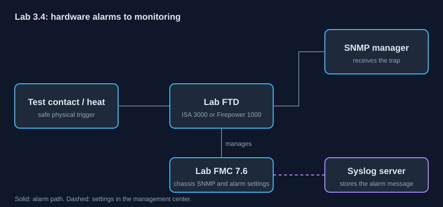

# Lab: Prove hardware alarms reach your monitoring (Firepower 1000 and ISA 3000)

Video: [How to Configure SNMP Monitoring & Hardware Alarms on Cisco Firepower 1000 & ISA 3000](https://youtu.be/xlNEB0Szl48)
Reference: Cisco Secure Firewall Management Center Device Configuration Guide 7.6,
chapters 19 and 23 (PDF pages 979-984 and 1193-1206). Check the guide for your exact version.

> **Use a lab FMC/FTD or a virtual lab, never production, and real Firepower 1000 or ISA 3000 hardware for the physical alarm steps.**

## Goal

Make sure the hardware can tell you it is in trouble. You add your monitoring server as an SNMP manager in the chassis-level settings, enable the ISA 3000 alarms, trigger a safe test and confirm the event reaches syslog and arrives as a trap.

## Background

- Syslog and NetFlow tell you what the firewall does with traffic. They do not tell you how the hardware is doing. Platform Settings (all devices) watch traffic, routing and security events; platform-specific settings watch the physical device: temperature, power, chassis faults and external contacts.
- SNMP building blocks: the manager is your monitoring server that collects data and receives traps; the agent is the device that reports (here the Firepower chassis); the MIB is the menu of what the agent can report, such as fan, voltage and power-supply states.
- Firepower 1000 chassis SNMP is configured per device, separately from the Platform Settings policy (in 7.6: Devices > Device Management > the device > SNMP; confirm the exact path in the guide for your version). SNMPv1/v2c use a community string of 1 to 32 characters; avoid @, backslash, ? and spaces, which break trap parsing. SNMPv3 levels: noauth (neither), auth (authentication only), priv (authentication and encryption). Use priv when traps cross an untrusted network.
- ISA 3000 physical alarms: alarm input contacts (an external sensor such as a cabinet door switch), power supply alarms (one of the power feeds drops) and temperature alarms (critical on a fanless device in an enclosed cabinet).

## Prerequisites

- A lab management center and threat defense.
- Real Firepower 1000 or ISA 3000 hardware for the physical alarm steps (use a lab device, never production).
- A lab SNMP manager that can receive traps and a lab syslog server.

Values you will use (keep them as placeholders in anything you share, never commit real values):

| Placeholder | What it is |
|---|---|
| `<SNMP_MANAGER>` | address of the lab monitoring server |
| `<SNMPV3_USER>` | SNMPv3 user name |
| `<SNMPV3_AUTH_SECRET>` | SNMPv3 authentication secret (never commit) |
| `<SNMPV3_PRIV_SECRET>` | SNMPv3 privacy secret (never commit) |
| `<DEVICE_NAME>` | the lab device |

## Steps

### Part 1: chassis SNMP

1. Open the device's chassis-level SNMP settings for `<DEVICE_NAME>`.
2. Add `<SNMP_MANAGER>` as an SNMP manager using SNMPv3 with priv (`<SNMPV3_USER>`, `<SNMPV3_AUTH_SECRET>`, `<SNMPV3_PRIV_SECRET>`).

### Part 2: ISA 3000 alarms

3. Enable the temperature, power-supply and input-contact alarms, with syslog and SNMP notification.
4. Deploy.

### Part 3: safe test

5. Trigger a safe test: close or open a test contact switch, or temporarily set a temperature threshold the device will cross.
6. Confirm the event appears in syslog and arrives as an SNMP trap at `<SNMP_MANAGER>`.
7. Restore the normal thresholds and redeploy.

## Check your work

Use [checklist.md](checklist.md). If something does not work, start with
[troubleshooting.md](troubleshooting.md).

## Clean up

Restore the normal alarm thresholds, remove the lab SNMP manager and deploy again.

---
*Always confirm behavior against the guide for your exact FMC/FTD version. Independent training by Hexward Labs; not affiliated with or endorsed by Cisco Systems.*
