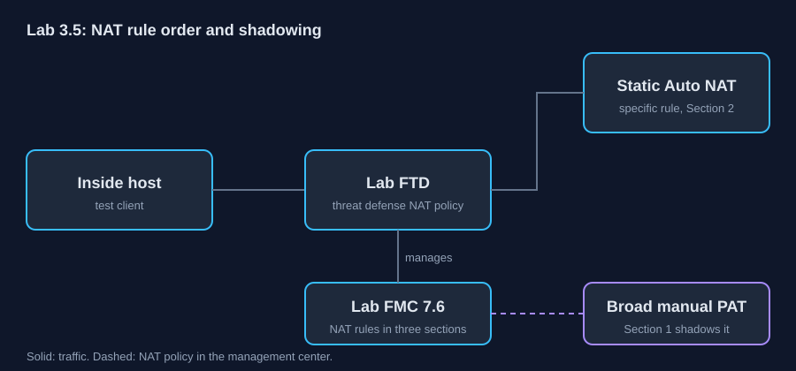

# Lab: Reproduce and fix NAT rule shadowing

Video: [NAT Basics: Auto NAT, Manual NAT, and Rule Order](https://youtu.be/y1L7d1wG1qg)
Reference: Cisco Secure Firewall Management Center Device Configuration Guide 7.6,
chapter 22 (PDF pages 1067-1088). Check the guide for your exact version.

> **Use a lab FMC/FTD or a virtual lab, never production.**

## Goal

See why most NAT outages are rule-order mistakes. You build a specific Auto NAT rule, shadow it with a broad Manual NAT rule in Section 1, prove it with packet-tracer, then move the broad rule to Section 3 and prove the fix.

## Background

- NAT rewrites the source and/or destination address (and optionally port) as traffic passes the firewall. Before you write any rule: the inside and outside interfaces are configured, named and up; you know which interface each translated flow leaves through; and the device can route traffic for the mapped addresses (see Routing NAT packets in the guide for your topology).
- Auto NAT (network object NAT) lives inside a network object, matches the object as the source and is sorted automatically by the device. Manual NAT (twice NAT) is a standalone rule that can match source and destination (and service) in one rule and you control the order.
- FTD evaluates NAT in three sections, top to bottom, and the first match wins: Section 1 Manual NAT (before Auto NAT) in the order you place them; Section 2 Auto NAT, ordered automatically (static before dynamic, then by how specific the real address is, then by IP address, then by object name); Section 3 Manual NAT (after Auto NAT) in the order you place them.
- Rule shadowing: a broad manual rule in Section 1, for example PAT for the whole inside subnet, matches before a specific Auto NAT rule in Section 2 is ever checked. The specific rule never takes effect.

## Prerequisites

- A lab management center and threat defense with named inside and outside interfaces and a working route outside.
- A lab inside host and a public-facing test destination.

Values you will use (keep them as placeholders in anything you share, never commit real values):

| Placeholder | What it is |
|---|---|
| `<HOST_IP>` | the test host's private address |
| `<PUBLIC_IP>` | a test destination address |
| `<MAPPED_IP>` | the host's static mapped address |
| `<INSIDE_SUBNET>` | the lab inside subnet |

## Steps

### Part 1: build the rules

1. In Devices > NAT, create an Auto NAT static rule for the test host `<HOST_IP>` (inside to outside, mapped `<MAPPED_IP>`).
2. Add a Manual NAT rule in Section 1: `<INSIDE_SUBNET>` to the outside interface, dynamic PAT.

### Part 2: prove the shadowing

3. Deploy, then run `packet-tracer input inside tcp <HOST_IP> 12345 <PUBLIC_IP> 443 detailed` on the device CLI.
4. Read the NAT phase: note which rule matched and the translated address.

### Part 3: fix and prove

5. Move the Manual NAT rule to After Auto NAT (Section 3), deploy and run the same packet-tracer.
6. Confirm the host now uses its own static translation.

## Check your work

Use [checklist.md](checklist.md). If something does not work, start with
[troubleshooting.md](troubleshooting.md).

## Clean up

Delete the lab NAT rules and objects and deploy again.

---
*Always confirm behavior against the guide for your exact FMC/FTD version. Independent training by Hexward Labs; not affiliated with or endorsed by Cisco Systems.*
