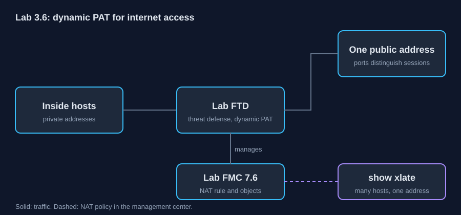

# Lab: Give an inside subnet internet access with one address

Video: [Dynamic NAT and PAT for Internet Access](https://youtu.be/h4TbDudK1N8)
Reference: Cisco Secure Firewall Management Center Device Configuration Guide 7.6,
chapter 22 (PDF pages 1089-1104). Check the guide for your exact version.

> **Use a lab FMC/FTD or a virtual lab, never production.**

## Goal

Let many inside hosts share one public address. You create the public address object, build the dynamic PAT rule, check hit counters and translations, then break it by choosing the wrong interface and watch the counter stop.

## Background

- Dynamic NAT maps one-to-one from a pool while the session lasts, so capacity is limited to the number of addresses in the pool. Dynamic PAT maps many-to-one, with each connection getting its own source port, so one public address supports thousands of concurrent connections.
- PAT normally uses source ports 1024 to 65535 on each mapped address. In clustered deployments ports are handed out to members in blocks; check the guide for the block allocation settings of your version.
- Define the public address once as a network object (host or range) and reuse it. When the public IP is the outside interface address itself, the rule can translate to the destination interface IP instead.

## Prerequisites

- A lab management center and threat defense with named inside and outside interfaces.
- A lab inside host that can browse a test site.

Values you will use (keep them as placeholders in anything you share, never commit real values):

| Placeholder | What it is |
|---|---|
| `<INSIDE_SUBNET_OBJECT>` | network object for the inside subnet |
| `<PUBLIC_OBJECT>` | network object for the public address (or use the outside interface IP) |
| `<INSIDE_HOST>` | a lab inside host |
| `<PUBLIC_IP>` | a test destination |

## Steps

### Part 1: build

1. In Objects > Object Management, create `<PUBLIC_OBJECT>` (or plan to use the outside interface IP).
2. In Devices > NAT, add a rule: Dynamic, inside to outside, original source `<INSIDE_SUBNET_OBJECT>`, translated source `<PUBLIC_OBJECT>`.

### Part 2: verify

3. Deploy. From `<INSIDE_HOST>`, open a few web pages.
4. On the device CLI run `show nat detail` and watch the translate hits increase on your rule.
5. Run `show xlate` to see inside hosts mapped to the public address with different ports.
6. Run `packet-tracer input inside tcp <INSIDE_HOST> 12345 <PUBLIC_IP> 443 detailed`.

### Part 3: break it on purpose

7. Change the destination interface to the wrong interface, deploy and observe the hit counter stop increasing. Revert.

## Check your work

Use [checklist.md](checklist.md). If something does not work, start with
[troubleshooting.md](troubleshooting.md).

## Clean up

Delete the lab NAT rule and objects and deploy again.

---
*Always confirm behavior against the guide for your exact FMC/FTD version. Independent training by Hexward Labs; not affiliated with or endorsed by Cisco Systems.*
