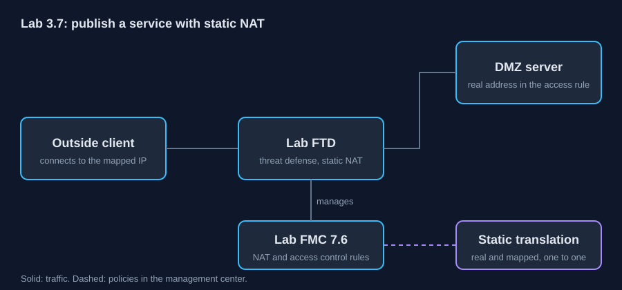

# Lab: Publish an HTTPS service safely with static NAT

Video: [Static NAT and Publishing Services](https://youtu.be/cQwscVqzwq4)
Reference: Cisco Secure Firewall Management Center Device Configuration Guide 7.6,
chapter 22 (PDF pages 1105-1113). Check the guide for your exact version.

> **Use a lab FMC/FTD or a virtual lab, never production.**

## Goal

Publish a DMZ service so it is reachable from outside and still inspected. You build the static mapping, write the access rule with the real destination address, test, then deliberately use the mapped address in the rule to see it fail.

## Background

- Static NAT is a fixed one-to-one mapping between a public (mapped) address and a private (real) address. Because the mapping never changes, connections can be started from the outside. PAT cannot publish a service because its ports are assigned on demand when an inside host connects out.
- Static Auto NAT lives inside the network object and is placed automatically (Section 2). Static Manual NAT is a standalone rule where you choose Section 1 or Section 3 and the position, and can match source and destination in one rule.
- The golden rule: in the access control rule, use the real (private) IP as the destination, not the mapped public IP. On an inbound packet the firewall un-translates the destination back to the real address before the access policy evaluates it. A rule written for the public address never matches and the traffic falls to the default action.
- You also need routing that brings the mapped address to the firewall.

## Prerequisites

- A lab management center and threat defense with outside and DMZ interfaces.
- A lab HTTPS server in the DMZ and an outside test client.

Values you will use (keep them as placeholders in anything you share, never commit real values):

| Placeholder | What it is |
|---|---|
| `<REAL_SERVER>` | network object for the server's real address |
| `<MAPPED_SERVER>` | network object for the mapped public address |
| `<CLIENT_IP>` | the outside test client |
| `<MAPPED_IP>` | the mapped public address |
| `<DMZ_ZONE>` | security zone of the DMZ interface |

## Steps

### Part 1: build

1. Create `<REAL_SERVER>` and `<MAPPED_SERVER>`.
2. In Devices > NAT, add a static rule (Auto NAT in the object, or Manual NAT) mapping real to mapped.
3. In the access control policy, add a rule: outside to `<DMZ_ZONE>`, destination `<REAL_SERVER>`, TCP 443, with an intrusion policy attached.

### Part 2: test

4. Deploy and test HTTPS from the outside host to `<MAPPED_IP>`.
5. Run `packet-tracer input outside tcp <CLIENT_IP> 40000 <MAPPED_IP> 443 detailed` and confirm the un-NAT to the real IP and then your access rule matching.

### Part 3: the classic mistake

6. Change the access rule destination to `<MAPPED_SERVER>`, deploy and confirm the connection now fails. Revert.

## Check your work

Use [checklist.md](checklist.md). If something does not work, start with
[troubleshooting.md](troubleshooting.md).

## Clean up

Delete the lab NAT and access rules and objects and deploy again.

---
*Always confirm behavior against the guide for your exact FMC/FTD version. Independent training by Hexward Labs; not affiliated with or endorsed by Cisco Systems.*
