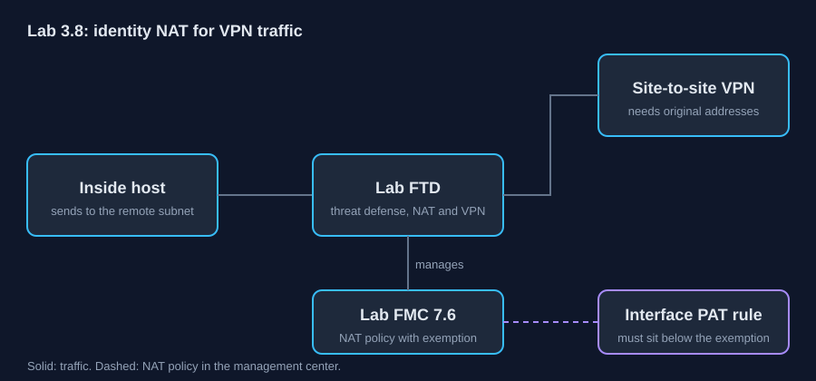

# Lab: Fix a VPN that is up but passes nothing, with identity NAT

Video: [Identity NAT and Translation Exemptions](https://youtu.be/XR6_VwLP4JA)
Reference: Cisco Secure Firewall Management Center Device Configuration Guide 7.6,
chapter 22 (PDF pages 1114-1123). Check the guide for your exact version.

> **Use a lab FMC/FTD or a virtual lab, never production, and a working site-to-site VPN.**

## Goal

Find the NAT problem behind a tunnel that looks healthy. You add a broad interface PAT rule, watch VPN traffic fail, prove with packet-tracer that PAT is translating the source, then add an identity NAT rule above it and prove the fix.

## Background

- The tunnel is up but no application traffic passes. The firewall translates the inside addresses before they reach the VPN, so packets no longer match the traffic the tunnel is built to encrypt. Identity NAT (NAT exemption) tells the firewall to leave that traffic untouched.
- Identity NAT translates an address to itself: the address stays the same and the traffic is kept out of broader translation rules such as interface PAT. Standard NAT or PAT changes source and/or destination; identity NAT leaves them unchanged. Typical uses are VPN traffic and routed paths that must keep real addresses.
- Rule tabs in the management center: the translation itself (original and translated addresses, identical for an exemption), the interface objects the rule applies to, and advanced options such as route lookup and proxy ARP behavior.
- Order matters: the exemption must be matched before any broader rule. A general PAT rule above it catches the VPN traffic first and translates it. Interfaces matter too: leaving source and destination interfaces as any applies the exemption everywhere, and unrelated traffic that needs translation, such as user internet access, can then leave untranslated with private addresses and be dropped upstream.

## Prerequisites

- A lab management center and threat defense with a working site-to-site VPN to a lab peer.
- An inside host and a host behind the remote end of the tunnel.

Values you will use (keep them as placeholders in anything you share, never commit real values):

| Placeholder | What it is |
|---|---|
| `<INSIDE_HOST>` | a lab inside host |
| `<REMOTE_HOST>` | a lab host behind the remote end of the VPN |
| `<INSIDE_SUBNET>` | the local VPN subnet |
| `<REMOTE_SUBNET>` | the remote VPN subnet |
| `<INSIDE_INTERFACE>` | the inside interface object |
| `<VPN_INTERFACE>` | the interface the tunnel leaves through |

## Steps

### Part 1: break it

1. With a working site-to-site VPN, add an interface PAT rule for `<INSIDE_SUBNET>` in Section 1 (above everything).
2. Deploy and send traffic from `<INSIDE_HOST>` to `<REMOTE_HOST>`. Note that it fails.
3. Run `packet-tracer input inside tcp <INSIDE_HOST> 12345 <REMOTE_HOST> 443 detailed` and confirm the PAT rule translates the source.

### Part 2: add the exemption

4. Add an identity NAT rule above the PAT rule with specific interfaces (`<INSIDE_INTERFACE>` and `<VPN_INTERFACE>`) and both source and destination (`<INSIDE_SUBNET>` and `<REMOTE_SUBNET>`) set to themselves.

### Part 3: prove the fix

5. Deploy and repeat the packet-tracer and the test traffic. The source should stay `<INSIDE_HOST>` and traffic should pass.
6. Check `show crypto ipsec sa` for increasing encrypt and decrypt counters.

## Check your work

Use [checklist.md](checklist.md). If something does not work, start with
[troubleshooting.md](troubleshooting.md).

## Clean up

Delete the lab PAT rule and the identity NAT rule (or keep the exemption if the VPN is a permanent lab) and deploy again.

---
*Always confirm behavior against the guide for your exact FMC/FTD version. Independent training by Hexward Labs; not affiliated with or endorsed by Cisco Systems.*
