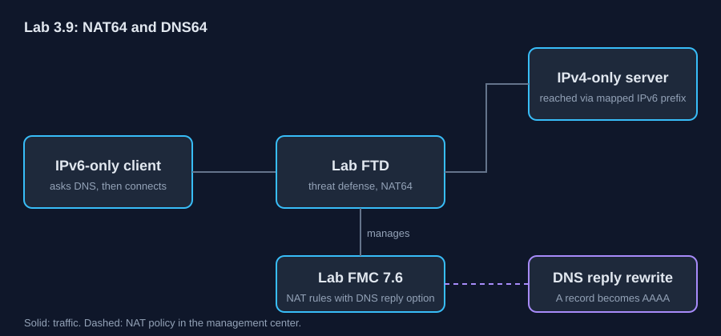

# Lab: IPv6-only client to an IPv4-only server with NAT64 and DNS64

Video: [IPv6 NAT: Scenarios and Limitations](https://youtu.be/fvqWKtMBPhY)
Reference: Cisco Secure Firewall Management Center Device Configuration Guide 7.6,
chapter 22 (PDF pages 1124-1136). Check the guide for your exact version.

> **Use a lab FMC/FTD or a virtual lab, never production.**

## Goal

Connect an IPv6-only client to an IPv4-only server. You build the objects and rules, see the connection fail because DNS returns only an A record, then enable DNS reply translation so the client receives a synthesized AAAA record.

## Background

- NAT66 translates IPv6 to another IPv6 address (static mapping between IPv6 networks, IPv6 interface PAT). NAT64 translates IPv6 to IPv4 so IPv6-only clients can reach IPv4 servers. NAT46 translates IPv4 to IPv6, representing IPv4 hosts with IPv6 addresses.
- NAT64 rebuilds the packet: the firewall removes the IPv6 header, builds an IPv4 header using an address from your IPv4 pool, and reverses it for the reply.
- Both sides need an address in the other family: the IPv6 client's source is translated into the IPv4 pool, and the IPv4 server must be reachable from the IPv6 side through a mapped IPv6 address, typically by mapping the IPv4 server or network into an IPv6 prefix.
- When the translated addresses are at least one hop away, the firewall needs routes for the remote networks and the upstream router needs routes that send traffic for the mapped addresses back to the firewall.
- The DNS trap: the IPv6 client asks DNS for the server, gets only an IPv4 A record and cannot use it, so the NAT64 rule never sees a packet. DNS64 reply modification (the NAT rule option to translate DNS replies) rewrites the A record into a synthesized IPv6 AAAA record so the client connects to the mapped IPv6 address and the NAT rule takes over.

## Prerequisites

- A lab management center and threat defense with an IPv6-only inside segment and an IPv4-only server outside.
- A DNS resolver the client uses that returns only an A record for the server.

Values you will use (keep them as placeholders in anything you share, never commit real values):

| Placeholder | What it is |
|---|---|
| `<IPV6_SUBNET>` | the inside IPv6 subnet |
| `<IPV4_POOL>` | the IPv4 pool used for translated sources |
| `<IPV6_SERVER_PREFIX>` | the IPv6 prefix that represents the IPv4 server |
| `<SERVER_NAME>` | the name of the IPv4-only server |

## Steps

### Part 1: build

1. Build an IPv6-only inside segment and an IPv4-only server outside.
2. Create objects for `<IPV6_SUBNET>`, `<IPV4_POOL>` and `<IPV6_SERVER_PREFIX>`.
3. Configure the NAT64 and NAT46 rules with specific interfaces. Leave DNS reply translation off at first.

### Part 2: see it fail

4. Deploy. From the client, connect to `<SERVER_NAME>`. It fails because DNS returns only an A record.

### Part 3: fix with DNS reply translation

5. Enable DNS reply translation on the rule, deploy and try again. The client now receives a AAAA record and connects.
6. Check `show nat detail` and `show xlate` for the IPv6 to IPv4 translations and `show route` on both families.

## Check your work

Use [checklist.md](checklist.md). If something does not work, start with
[troubleshooting.md](troubleshooting.md).

## Clean up

Delete the lab NAT64/NAT46 rules and objects and deploy again.

---
*Always confirm behavior against the guide for your exact FMC/FTD version. Independent training by Hexward Labs; not affiliated with or endorsed by Cisco Systems.*
