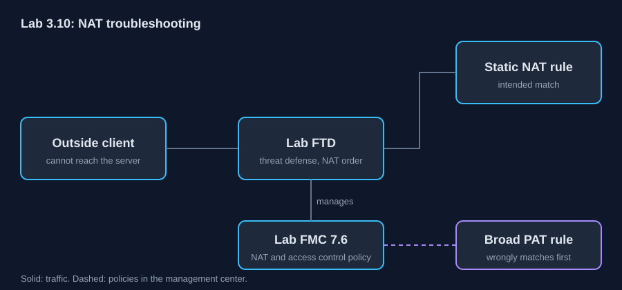

# Lab: Find the NAT rule that is swallowing your traffic

Video: [NAT Troubleshooting Through Configuration Examples](https://youtu.be/efT1-slDIR4)
Reference: Cisco Secure Firewall Management Center Device Configuration Guide 7.6,
chapter 22 (PDF pages 1137-1192). Check the guide for your exact version.

> **Use a lab FMC/FTD or a virtual lab, never production.**

## Goal

Troubleshoot NAT in the right order: reachability, then NAT, then access control. You publish a lab server, place a broad PAT rule above the static rule, observe the failure with hit counters and packet-tracer, then reorder and verify.

## Background

- Observe before you change anything, working from the bottom up: basic reachability, then NAT, then access control. Before troubleshooting, write down three facts: where the server lives (inside or DMZ network and real address), where external traffic arrives (outside interface), and which translation you intended (static mapping or pool, and the mapped address).
- NAT rule order, first match wins: Section 1 Manual NAT (highest priority) for specific exceptions and precise static one-to-one translations; Section 2 Auto NAT (object NAT); Section 3 Manual NAT after Auto NAT for broad fallback or cleanup rules.
- Translate hits tell the truth: the hit counter on each rule in show nat and show nat detail shows which rule is actually catching your traffic in real time.
- Dynamic PAT is many-to-one and creates translations only when an inside host connects out. An unsolicited inbound packet has no existing translation to use, so a service behind PAT is unreachable. Publishing needs a static mapping.

## Prerequisites

- A lab management center and threat defense with outside and inside or DMZ interfaces.
- A lab server and an outside test client.

Values you will use (keep them as placeholders in anything you share, never commit real values):

| Placeholder | What it is |
|---|---|
| `<CLIENT_IP>` | the outside test client |
| `<MAPPED_IP>` | the server's mapped address |
| `<SERVER_IP>` | the server's real address |
| `<INSIDE_SUBNET>` | the lab inside subnet |

## Steps

### Part 1: set up the problem

1. Publish a lab server with a static NAT rule and a matching access rule (destination is the real address `<SERVER_IP>`).
2. Add a broad dynamic PAT rule for `<INSIDE_SUBNET>` and place it so it is evaluated before the static rule.
3. Deploy and try to reach the server from outside. Note that it fails.

### Part 2: observe

4. Check basic reachability first (`ping system` from the device CLI) and confirm the management center shows the device healthy with the latest deployment applied.
5. Run `show nat detail` and compare the translate hits on both rules.
6. Run `packet-tracer input outside tcp <CLIENT_IP> 40000 <MAPPED_IP> 443 detailed` and read which NAT rule and which drop reason appear.

### Part 3: fix

7. Reorder the rules so the specific static rule comes first, deploy, and repeat the observations.
8. Check `show conn address <SERVER_IP>` for active connections with bytes in both directions.

## Check your work

Use [checklist.md](checklist.md). If something does not work, start with
[troubleshooting.md](troubleshooting.md).

## Clean up

Delete the lab NAT and access rules and deploy again.

---
*Always confirm behavior against the guide for your exact FMC/FTD version. Independent training by Hexward Labs; not affiliated with or endorsed by Cisco Systems.*
