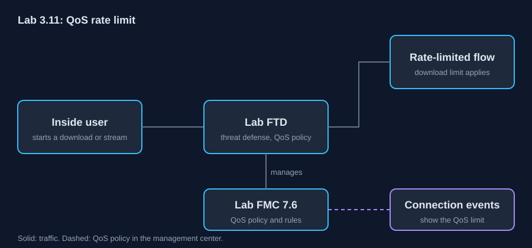

# Lab: Rate limit one application with QoS and prove it

Video: [QoS: Traffic Priorities and Limits](https://youtu.be/Ek01WOXWLrs)
Reference: Cisco Secure Firewall Management Center Device Configuration Guide 7.6,
chapter 20 (PDF pages 985-996). Check the guide for your exact version.

> **Use a lab FMC/FTD or a virtual lab, never production.**

## Goal

Keep business-critical traffic from being squeezed by greedy traffic. You build a QoS policy with one application rule and a small, measurable download limit, test it, and find the rate-limited connections and the QoS information in the connection events.

## Background

- QoS on management center managed devices rate limits (polices) traffic. It applies only to traffic that the access control policy allows or trusts. Traffic that a prefilter policy fastpaths bypasses that evaluation, so QoS does not limit it.
- A QoS policy is built centrally in the management center (Devices > QoS) and assigned to one or more managed devices; a device can have only one deployed QoS policy at a time. QoS applies to routed interfaces; site-to-site VPN traffic and virtual tunnel interfaces (VTIs) are not supported.
- Rules are evaluated top-down and the first match wins. No more than 255 QoS rules per device; going over triggers a deployment warning. The required condition is the interface (source or destination) where the limit applies; optional conditions are applications (for example a video streaming filter), users, networks and ports or protocols.
- Direction is based on the initiator. Each rule sets an independent download and upload limit (Mbps). Download is traffic toward the connection initiator, so if an inside user starts a stream from an outside server, the returning video is download traffic.
- Limits are per interface, not shared: a 10 Mbps limit on an interface group with three interfaces allows up to 10 Mbps on each interface, 30 Mbps in total. There is no aggregate limit across several interfaces.

## Prerequisites

- A lab management center and threat defense with a routed inside interface.
- An access control rule that allows the test traffic with Log at End of Connection enabled.
- An inside host that can run a large download or stream.

Values you will use (keep them as placeholders in anything you share, never commit real values):

| Placeholder | What it is |
|---|---|
| `<QOS_POLICY>` | name of the lab QoS policy |
| `<INSIDE_INTERFACE>` | the inside routed interface object |
| `<APPLICATION>` | the application or filter to limit |
| `<DOWNLOAD_LIMIT>` | a small download limit in Mbps that you can measure |
| `<DEVICE_NAME>` | the lab device |

## Steps

### Part 1: build

1. Confirm the access control rule that allows the test traffic has Log at End of Connection enabled.
2. In Devices > QoS, create `<QOS_POLICY>` and assign it to `<DEVICE_NAME>`.
3. Add a rule: interface `<INSIDE_INTERFACE>`, application `<APPLICATION>`, download limit `<DOWNLOAD_LIMIT>`.

### Part 2: test

4. Deploy, then start a large download or stream from an inside host and measure the speed.
5. Open the connection events and find the rate-limited connections and the QoS information they show.

### Part 3: bonus

6. Add a second interface to the rule and confirm each interface gets its own full limit.

## Check your work

Use [checklist.md](checklist.md). If something does not work, start with
[troubleshooting.md](troubleshooting.md).

## Clean up

Remove the lab QoS policy from the device and delete it, then deploy again.

---
*Always confirm behavior against the guide for your exact FMC/FTD version. Independent training by Hexward Labs; not affiliated with or endorsed by Cisco Systems.*
