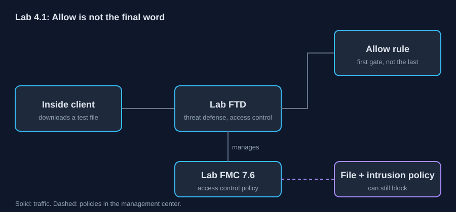

# Lab: Prove that Allow is not the final word

Video: [How Does Access Control Evaluate Connections?](https://youtu.be/jqqgeTQ-Iz0)
Reference: Cisco Secure Firewall Management Center Device Configuration Guide 7.6,
chapter 41 (PDF pages 1767-1784). Check the guide for your exact version.

> **Use a lab FMC/FTD or a virtual lab, never production.**

## Goal

See that an Allow rule is only the first step. You allow web traffic with no inspection, download a harmless antivirus test file, then attach a file policy and an intrusion policy and watch the same download get blocked.

## Background

- Rules are evaluated top to bottom and the first matching rule decides the action. With policy inheritance, the base policy's Mandatory rules are evaluated before the local policy's rules and the base policy's Default section is evaluated last. If no rule matches, the default action applies (for example Block all traffic, Trust all traffic, Network Discovery only or Intrusion Prevention).
- Block drops the connection immediately with no further inspection. Allow permits the connection at the access gate, then hands it to the attached file/malware policy and intrusion policy. Trust passes without deep inspection; use it only for traffic you truly trust.
- The file policy looks for prohibited file types and known malware inside files. The intrusion policy examines the payload for exploits and malicious behavior that a file check can miss.
- Final decision: if the access rule allows a connection but the file policy or intrusion policy blocks it, the connection is blocked. Deep inspection overrides the initial allow. If no inspection policies are attached, the traffic passes with no deeper checks.

## Prerequisites

- A lab management center and threat defense with inside and outside security zones defined.
- An inside host and a harmless antivirus test file source (for example the EICAR test file).

Values you will use (keep them as placeholders in anything you share, never commit real values):

| Placeholder | What it is |
|---|---|
| `<ACP_NAME>` | the lab access control policy |
| `<INSIDE_ZONE>` | inside security zone |
| `<OUTSIDE_ZONE>` | outside security zone |
| `<FILE_POLICY>` | a file policy with malware blocking |
| `<INTRUSION_POLICY>` | a lab intrusion policy |
| `<CLIENT_IP>` | the inside test client |
| `<SERVER_IP>` | the test download server |

## Steps

### Part 1: Allow with no inspection

1. In `<ACP_NAME>`, create an Allow rule for `<INSIDE_ZONE>` to `<OUTSIDE_ZONE>` web traffic with no file or intrusion policy. Enable logging at end of connection.
2. Deploy and download a standard antivirus test file from `<CLIENT_IP>`. Note that it succeeds.

### Part 2: add inspection

3. Attach `<FILE_POLICY>` and `<INTRUSION_POLICY>` to the same rule and deploy.
4. Repeat the download. Confirm it is now blocked.

### Part 3: compare

5. Compare the connection events and file/malware events for both attempts.
6. Run `packet-tracer input inside tcp <CLIENT_IP> 40000 <SERVER_IP> 443 detailed` and confirm the expected access rule matches.

## Check your work

Use [checklist.md](checklist.md). If something does not work, start with
[troubleshooting.md](troubleshooting.md).

## Clean up

Remove the lab rule and inspection policies from the access control policy and deploy again.

---
*Always confirm behavior against the guide for your exact FMC/FTD version. Independent training by Hexward Labs; not affiliated with or endorsed by Cisco Systems.*
