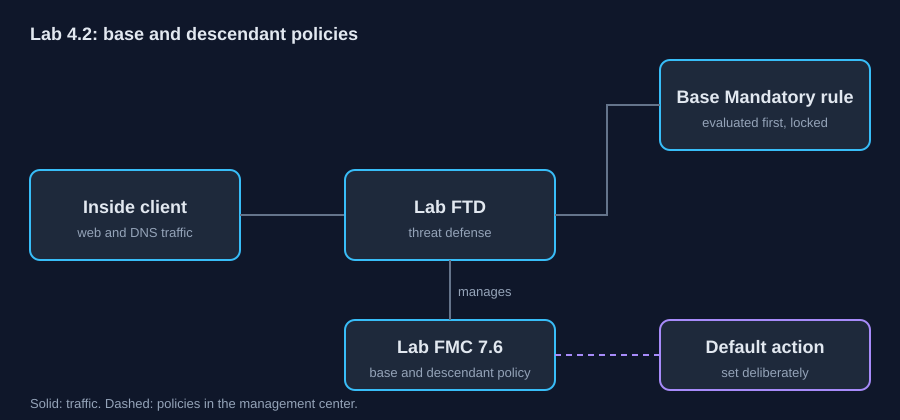

# Lab: Build a two-level access control policy safely

Video: [How to Configure Access Control Policy (ACP) in Cisco FMC & FTD Step-by-Step](https://youtu.be/OK3VISqkJ9s)
Reference: Cisco Secure Firewall Management Center Device Configuration Guide 7.6,
chapter 42 (PDF pages 1785-1816). Check the guide for your exact version.

> **Use a lab FMC/FTD or a virtual lab, never production.**

## Goal

Build the policy structure in a safe order. You create a base policy with a locked Mandatory Block rule, a descendant that adds local Allow rules, prove the base rule wins, and deliberately cause (and repair) the outage a Block all default action can create.

## Background

- A base (parent) access control policy holds the global standard, for example blocking known malicious IP addresses and high-risk web categories. Descendant (child) policies inherit those settings and add local rules. The result is consistent security across many devices without rewriting the same rules on each.
- The base policy's Mandatory rules are evaluated before descendant rules, and locked settings cannot be changed downstream. A local Allow rule cannot override a base Block rule there.
- Prerequisites: valid Smart Licensing for the features you use (IPS, malware defense, URL filtering); network and port objects defined so rules stay readable; interfaces, zones and routing configured on the device.
- Safe build order: choose the base policy, lock the settings that must never change, set the default action deliberately, assign the policy to devices and deploy.
- Device assignment can fail when the device lacks a license the policy needs (for example intrusion rules without an IPS license), when the model does not support a feature, or when an inline blocking policy is pushed to a passive sensor.
- A branch firewall can lose every phone call and cloud app at once when the default action is Block all traffic and no rules exist yet for the branch subnets or DNS: every packet falls to the bottom and is dropped.

## Prerequisites

- A lab management center and at least one lab threat defense (ideally a second one that lacks a required license).

Values you will use (keep them as placeholders in anything you share, never commit real values):

| Placeholder | What it is |
|---|---|
| `<BASE_POLICY>` | name of the lab base policy |
| `<CHILD_POLICY>` | name of the lab descendant policy |
| `<TEST_HOST_OBJECT>` | a test host object that stands for a malicious host |
| `<INSIDE_SUBNET>` | the lab inside subnet |
| `<CLIENT_IP>` | a lab inside host |
| `<DNS_IP>` | the lab DNS server |

## Steps

### Part 1: base and descendant

1. Create `<BASE_POLICY>` with one Mandatory Block rule for `<TEST_HOST_OBJECT>` and lock its settings.
2. Create `<CHILD_POLICY>` inheriting from it and add an Allow rule for `<INSIDE_SUBNET>` to DNS and web.

### Part 2: prove precedence

3. In the descendant add an Allow rule for the same test host. Deploy and confirm traffic to it is still blocked by the base rule.
4. Run `packet-tracer input inside udp <CLIENT_IP> 53000 <DNS_IP> 53 detailed` and confirm the expected rule, not the default action.

### Part 3: the default action

5. Temporarily set the default action to Block all traffic and remove the Allow rule for DNS. Deploy and observe the outage. Restore it.
6. Assign the policy to a second lab device that lacks a required license and note the deployment error.
7. On the device CLI run `show access-control-config` to see the deployed policy name and default action.

## Check your work

Use [checklist.md](checklist.md). If something does not work, start with
[troubleshooting.md](troubleshooting.md).

## Clean up

Restore the default action and rules, unassign and delete the lab policies and deploy again.

---
*Always confirm behavior against the guide for your exact FMC/FTD version. Independent training by Hexward Labs; not affiliated with or endorsed by Cisco Systems.*
