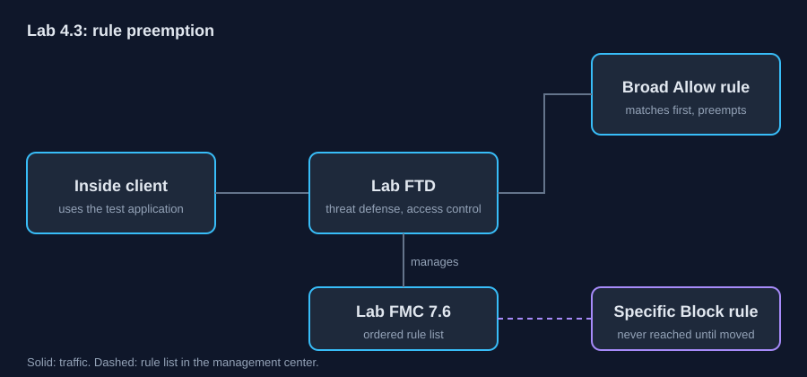

# Lab: Find and fix a shadowed access control rule

Video: [Access Control Rules: Conditions, Order, and Actions](https://youtu.be/3ncYYUc66JE)
Reference: Cisco Secure Firewall Management Center Device Configuration Guide 7.6,
chapter 43 (PDF pages 1817-1837). Check the guide for your exact version.

> **Use a lab FMC/FTD or a virtual lab, never production.**

## Goal

Understand rule preemption, one of the most common access control mistakes. You create a broad Allow rule above a specific Block rule, watch the Block never trigger, then move it and prove the fix. Bonus: see how a Monitor rule behaves.

## Background

- Four steps for every connection: match the traffic against rule conditions; evaluate rules top-down by rule number; apply the action of the first matching rule; hand off to deep inspection (intrusion, file/malware) when the action allows it.
- Match conditions: security zones and interfaces; networks; applications; ports and protocols; users and groups (which requires an identity policy associated with the access control policy, otherwise user conditions do not match).
- Prefer applications over ports: applications can run on non-standard ports and malicious traffic can use a trusted port such as 443. Application conditions identify the traffic itself regardless of port.
- Actions: Block drops the traffic immediately; Monitor logs the connection and continues evaluating the rules below; Allow permits the traffic and enables deep inspection; Trust permits the traffic without deep inspection.
- First match wins: once a rule matches, every rule below it is ignored for that connection. A broad rule placed above a specific rule preempts it.

## Prerequisites

- A lab management center, threat defense and an access control policy you can edit.
- An inside host and an application you can test (for example a specific web application).

Values you will use (keep them as placeholders in anything you share, never commit real values):

| Placeholder | What it is |
|---|---|
| `<ACP_NAME>` | the lab access control policy |
| `<TEST_APPLICATION>` | an application you can test and block |
| `<INSIDE_ZONE>` | inside security zone |
| `<OUTSIDE_ZONE>` | outside security zone |
| `<CLIENT_IP>` | the inside test client |

## Steps

### Part 1: create the shadow

1. In `<ACP_NAME>` create Rule 1: Allow `<INSIDE_ZONE>` to `<OUTSIDE_ZONE>`, any application. Create Rule 2 below it: Block `<TEST_APPLICATION>`.
2. Deploy and use the application from `<CLIENT_IP>`. It works.
3. Look at the rule list: note any warning or conflict icon on Rule 2 and the hit count staying at zero.

### Part 2: fix

4. Move Rule 2 above Rule 1, deploy and test again. The application is now blocked and Rule 2's hit count increases.

### Part 3: bonus

5. Add a Monitor rule above both and confirm it logs the connection while evaluation continues to the next rule.
6. Run `packet-tracer ... detailed` for a test flow and confirm it names the expected rule.

## Check your work

Use [checklist.md](checklist.md). If something does not work, start with
[troubleshooting.md](troubleshooting.md).

## Clean up

Delete the lab rules and deploy again.

---
*Always confirm behavior against the guide for your exact FMC/FTD version. Independent training by Hexward Labs; not affiliated with or endorsed by Cisco Systems.*
