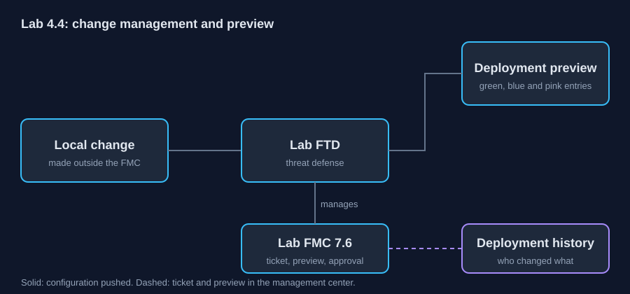

# Lab: Catch an out-of-band change before it bites

Video: [Cisco FMC Access Control Rules: How to Manage Rules & Interpret Test Results](https://youtu.be/rsNaeNvAbbk)
Reference: Cisco Secure Firewall Management Center Device Configuration Guide 7.6,
chapter 43 (PDF pages 1838-1856). Check the guide for your exact version.

> **Use a lab FMC/FTD or a virtual lab, never production.**

## Goal

Never deploy blind. You enable change management, make a change on the lab device that the management center does not know about, find it in the deployment preview, reconcile it and deploy under an approved ticket.

## Background

- Change management is a formal process in the management center: changes are tracked in tickets, reviewed and approved before deployment. It is disabled by default; enable it under System > Configuration > Change Management (confirm the path for your version). Before enabling it, make sure no backups, restores, upgrades or domain moves are running. To disable or change it later, existing tickets must be in a terminal state (approved or discarded).
- Ticket lifecycle: create and open a ticket; make configuration changes under that ticket; preview and review; an authorized user approves or rejects; deploy only after approval.
- Deployment preview colors: green means configuration will be added to the device; blue means existing device configuration will be modified; pink means configuration that exists on the device will be removed or disassociated.
- Out-of-band changes: the preview compares the management center configuration with what is running on the device and warns (yellow banner) when local changes were made outside the management center. It does not import them automatically; you must reconcile by entering the same values in the management center before you deploy.
- Acknowledge is not accept: acknowledging the difference and deploying without updating the management center means the device is overwritten with the management center configuration. The management center is the source of truth at deployment time.
- Deployment history keeps an audit trail: downloadable reports of additions, modifications and deletions, plus which users modified the policy and which user last modified each rule.

## Prerequisites

- A lab management center and a lab threat defense (never production).
- Permission to enable change management and to approve tickets in the lab.

Values you will use (keep them as placeholders in anything you share, never commit real values):

| Placeholder | What it is |
|---|---|
| `<TICKET_NAME>` | name of the lab change ticket |
| `<LAB_INTERFACE>` | a lab-only interface used for the local change |
| `<DEVICE_NAME>` | the lab device |

## Steps

### Part 1: set up

1. Enable change management in the lab management center.
2. Make a local change on `<DEVICE_NAME>` that the management center does not know about, for example on `<LAB_INTERFACE>`.

### Part 2: preview

3. Open `<TICKET_NAME>`, add an unrelated rule and open the deployment preview.
4. Find the out-of-band warning (yellow banner) and the pink entries.

### Part 3: reconcile and deploy

5. Reconcile by entering the same values in the management center, regenerate the preview and confirm the pink entries are gone.
6. Approve the ticket, deploy and download the deployment history report.
7. On the device run `show running-config interface` and `show route` to confirm the expected values.

## Check your work

Use [checklist.md](checklist.md). If something does not work, start with
[troubleshooting.md](troubleshooting.md).

## Clean up

Revert the lab local change and the unrelated lab rule. Disable change management if you do not need it (tickets must be in a terminal state first).

---
*Always confirm behavior against the guide for your exact FMC/FTD version. Independent training by Hexward Labs; not affiliated with or endorsed by Cisco Systems.*
