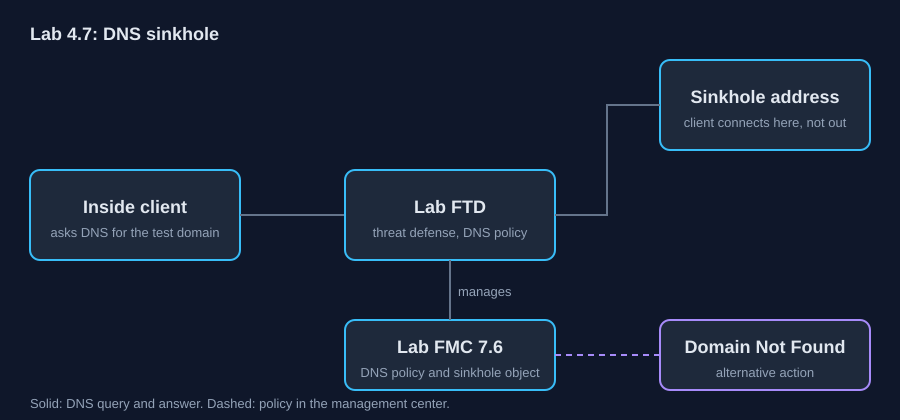

# Lab: Sinkhole a test domain with a DNS policy

Video: [DNS Policies, Sinkholes, and Umbrella Integration](https://youtu.be/z6VqlrHdVBI)
Reference: Cisco Secure Firewall Management Center Device Configuration Guide 7.6,
chapters 47 and 34 (PDF pages 1949-1966, 1493-1494). Check the guide for your exact version.

> **Use a lab FMC/FTD or a virtual lab, never production.**

## Goal

Stop a threat at the DNS lookup, before any connection exists. You create a custom DNS list with a lab-only domain, sinkhole it, confirm the client receives the sinkhole address, then switch to Domain Not Found and compare.

## Background

- Malware with fast-flux DNS rotates IP addresses faster than IP block lists can follow, but the infected host still has to ask DNS where to go. A DNS policy inspects those queries and acts before the client opens a connection to the resolved address.
- Main DNS rule actions: Allow or Do not block returns the normal answer. Domain Not Found returns a non-existent domain response and kills the lookup cleanly. Sinkhole returns a forged answer that points to a sinkhole address you control; the infected host then tries to connect to it, which both stops the threat and identifies the host.
- Conditions: source security zone, source networks and VLAN tags, and DNS lists and feeds, including Cisco Talos Security Intelligence feeds for categories such as phishing and command-and-control.
- Cisco Umbrella integration sends DNS queries to a cloud DNS security service. It needs the Umbrella connection configured in the management center (including the API credentials) and an Umbrella DNS policy. Follow the guide for the exact steps in your version.
- Order of events: DNS resolution happens before the IP connection. A sinkholed or not-found query never gives the client the real address, so a broad Allow rule later in the access control policy does not come into play for that domain.
- Limit: DNS-based blocking helps only when the malware uses DNS. Traffic to a hard-coded address still needs IP-based Security Intelligence and access control.

## Prerequisites

- A lab management center and threat defense (never production).
- A lab-only test domain you control and an inside host that resolves through the firewall.

Values you will use (keep them as placeholders in anything you share, never commit real values):

| Placeholder | What it is |
|---|---|
| `<DNS_POLICY>` | name of the lab DNS policy |
| `<ACP_NAME>` | the lab access control policy |
| `<TEST_DOMAIN>` | a lab-only domain you control |
| `<SINKHOLE_OBJECT>` | the sinkhole object |
| `<SINKHOLE_IP>` | the sinkhole address you control |
| `<INSIDE_ZONE>` | inside security zone |
| `<CLIENT_IP>` | the inside test client |

## Steps

### Part 1: build the policy

1. Create a custom DNS list containing `<TEST_DOMAIN>`.
2. Create `<SINKHOLE_OBJECT>` pointing to `<SINKHOLE_IP>` and a rule in `<DNS_POLICY>` that sinkholes the list for `<INSIDE_ZONE>`.
3. Link `<DNS_POLICY>` to `<ACP_NAME>` and deploy. A saved but unlinked policy does nothing.

### Part 2: test

4. From `<CLIENT_IP>` resolve `<TEST_DOMAIN>` and confirm the answer is `<SINKHOLE_IP>`.
5. Try to connect to the domain, then filter connection and Security Intelligence events by `<SINKHOLE_IP>` or the DNS rule name.

### Part 3: compare

6. Change the action to Domain Not Found, deploy and compare what the client receives.

## Check your work

Use [checklist.md](checklist.md). If something does not work, start with
[troubleshooting.md](troubleshooting.md).

## Clean up

Remove the lab DNS rule, list and sinkhole object, unlink the DNS policy and deploy again.

---
*Always confirm behavior against the guide for your exact FMC/FTD version. Independent training by Hexward Labs; not affiliated with or endorsed by Cisco Systems.*
