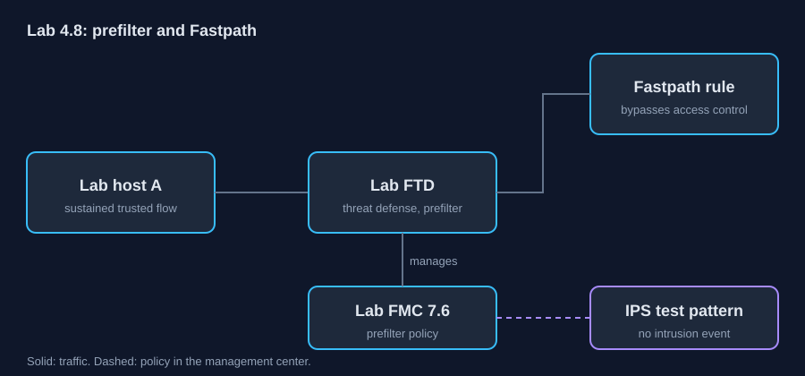

# Lab: Fastpath one flow, and only one

Video: [Prefilter and Fastpath: Benefits and Inspection Implications](https://youtu.be/kT9JPss9wUM)
Reference: Cisco Secure Firewall Management Center Device Configuration Guide 7.6,
chapter 48 (PDF pages 1967-1988). Check the guide for your exact version.

> **Use a lab FMC/FTD or a virtual lab, never production.**

## Goal

Use Fastpath for the one flow that justifies it and see the cost. You generate a sustained flow, fastpath only those two hosts, compare CPU and events, then send an IPS test pattern inside the flow and confirm no intrusion event appears.

## Background

- The prefilter policy is the first stage of policy evaluation. It acts on outer headers only, at high speed and low CPU cost. Fastpath is an action inside a prefilter rule: fastpathed traffic bypasses the access control policy and Snort inspection entirely.
- Access control is deep (IPS, file/malware, applications) and costs more CPU; prefilter looks at outer headers only and suits known, trusted high-volume flows and tunnel handling.
- Prefilter conditions: networks, VLAN tags, ports, time and day, and tunnel or encapsulation conditions (for example GRE).
- GRE on threat defense: do not try to handle it with a protocol-47 access rule. Encapsulated traffic is handled with tunnel rules in the prefilter policy, matched on the outer headers.
- The trade-off: Fastpath means no IPS and no malware inspection for those flows. Applying it broadly to improve performance creates blind spots an attacker can use.

## Prerequisites

- A lab management center and threat defense (never production).
- Two lab hosts that can exchange a sustained flow (a large file copy or a traffic generator).

Values you will use (keep them as placeholders in anything you share, never commit real values):

| Placeholder | What it is |
|---|---|
| `<PREFILTER_POLICY>` | name of the lab prefilter policy |
| `<HOST_A>` | first lab host |
| `<HOST_B>` | second lab host |
| `<SERVICE_PORT>` | the port used by the test flow |
| `<IPS_TEST_PATTERN>` | a harmless IPS test pattern for your lab |

## Steps

### Part 1: baseline

1. Generate a sustained flow between `<HOST_A>` and `<HOST_B>`. Note device CPU and the connection events.

### Part 2: fastpath

2. In `<PREFILTER_POLICY>` add a rule matching only `<HOST_A>`, `<HOST_B>` and `<SERVICE_PORT>`, with action Fastpath. Deploy.
3. Repeat the test and compare CPU and events. The flow now shows as fastpathed by the prefilter rule.
4. Run `packet-tracer input inside tcp <HOST_A> 40000 <HOST_B> <SERVICE_PORT> detailed` and confirm it shows the prefilter fastpath decision.

### Part 3: the blind spot

5. Send `<IPS_TEST_PATTERN>` inside the fastpathed flow and confirm no intrusion event is generated.
6. Narrow or remove the rule as needed.

## Check your work

Use [checklist.md](checklist.md). If something does not work, start with
[troubleshooting.md](troubleshooting.md).

## Clean up

Remove the Fastpath rule, restore the prefilter policy and deploy again.

---
*Always confirm behavior against the guide for your exact FMC/FTD version. Independent training by Hexward Labs; not affiliated with or endorsed by Cisco Systems.*
