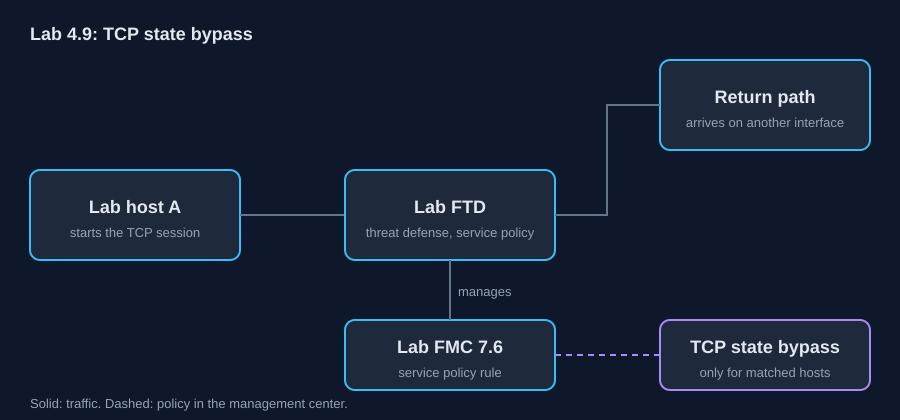

# Lab: Fix an asymmetric flow with TCP state bypass

Video: [Service Policies: Settings for Specific Connections](https://youtu.be/WOXkqfyBxQQ)
Reference: Cisco Secure Firewall Management Center Device Configuration Guide 7.6,
chapter 49 (PDF pages 1989-2006). Check the guide for your exact version.

> **Use a lab FMC/FTD or a virtual lab, never production.**

## Goal

Change connection behavior for one flow without weakening everything else. You reproduce TCP state drops caused by asymmetric routing, then add a global service policy rule with an extended access list that bypasses TCP state checking for only the test hosts.

## Background

- The access control policy applies to all connections (allow, block, deep inspection) and enforces TCP state. A threat defense service policy applies only to flows you select with an extended access list and tunes connection-level behavior, including bypassing TCP state for that flow.
- A service policy rule has three steps. Interface: a specific interface, or a global rule for all interfaces; for asymmetric routing global is safer because return traffic may arrive on a different interface. Traffic flow: an extended access list matching only the affected endpoints. Connection settings: for example maximum connections, idle timeouts and TCP state bypass.
- Asymmetric routing means the packets of one connection leave through one path and return through another. The firewall sees half of each connection and drops it, exactly as stateful inspection is designed to do.
- TCP state bypass turns off TCP state checking only for the matched flow. Use it as narrowly as possible, because those connections lose stateful protection. The real fix is symmetric routing.
- Avoid FlexConfig conflicts: QoS and service policy settings are merged into one policy map per interface. Conflicting manual policy maps in FlexConfig plus native service policies can cause deployment failures or unpredictable behavior. Prefer the native service policy.

## Prerequisites

- A lab management center and threat defense (never production).
- A lab layout where traffic leaves through the firewall but returns through another path or interface.

Values you will use (keep them as placeholders in anything you share, never commit real values):

| Placeholder | What it is |
|---|---|
| `<HOST_A>` | first lab host |
| `<HOST_B>` | second lab host |
| `<EXT_ACL>` | extended access list matching only the two test hosts |
| `<SERVICE_POLICY_RULE>` | name of the lab service policy rule |
| `<SERVICE_PORT>` | the port used by the test session |

## Steps

### Part 1: reproduce

1. Start a TCP session between `<HOST_A>` and `<HOST_B>` over the asymmetric layout and observe the drops.
2. On the device CLI run `show asp drop` and note the TCP state-related drop counters increasing.

### Part 2: fix narrowly

3. Create `<EXT_ACL>` matching only the test hosts and `<SERVICE_PORT>`.
4. Add a global service policy rule `<SERVICE_POLICY_RULE>` using that list and enable TCP state bypass. Deploy.

### Part 3: verify

5. Repeat the test. The session now works.
6. Run `show service-policy` to confirm the rule is applied and `show conn` to see the bypassed connection.

## Check your work

Use [checklist.md](checklist.md). If something does not work, start with
[troubleshooting.md](troubleshooting.md).

## Clean up

Remove the service policy rule and the lab access list, then deploy again.

---
*Always confirm behavior against the guide for your exact FMC/FTD version. Independent training by Hexward Labs; not affiliated with or endorsed by Cisco Systems.*
