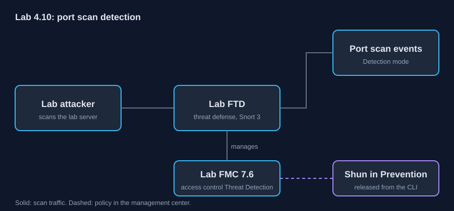

# Lab: Detect, then prevent, a port scan

Video: [Threat Detection for Portscan Activity](https://youtu.be/kten7_DZWUE)
Reference: Cisco Secure Firewall Management Center Device Configuration Guide 7.6,
chapter 50 (PDF pages 2007-2016). Check the guide for your exact version.

> **Use a lab FMC/FTD or a virtual lab, never production.**

## Goal

Turn reconnaissance into events. You enable Threat Detection in Detection mode, scan a lab server you own, find the events, switch to Prevention to block the scanner, release it from the CLI, then exclude your own scanner.

## Background

- Where it lives (7.2 and later): access control policy > Advanced > Threat Detection. The feature runs in the data plane on devices using Snort 3.
- Modes: Disable is the default. Detection generates events only and is the recommended starting point. Prevention detects and blocks (shuns) the scanner for a configured duration (default 3600 seconds).
- What to configure: scan types and protocols (TCP, UDP, ICMP; port scans and sweeps), which traffic to evaluate (permitted, denied or all), and lists of scanners and targets to ignore plus hosts to exclude from blocking.
- Sensitivity: Low has the shortest time window and catches only the most aggressive scanners. Medium (default) catches most common scans, but busy hosts such as NAT or proxies may need to be ignored. High has the longest window and catches even slow scans, with the most events and false positives.
- A blocked host stays shunned for the configured duration. To release it early use the device CLI: check with `show threat-detection portscan` and clear with `clear threat-detection portscan attacker <ATTACKER_IP> <HOST_MASK>`. The host can be blocked again if it keeps scanning.

## Prerequisites

- A lab management center and a threat defense on a release with the Snort 3 engine (never production).
- A lab attacker host and a lab server. Only scan hosts you own.

Values you will use (keep them as placeholders in anything you share, never commit real values):

| Placeholder | What it is |
|---|---|
| `<ACP_NAME>` | the lab access control policy |
| `<ATTACKER_IP>` | the lab attacker host |
| `<SERVER_IP>` | the lab server being scanned |
| `<HOST_MASK>` | the mask that identifies a single host |
| `<LAB_SCANNER>` | your lab vulnerability scanner |

## Steps

### Part 1: detect

1. In `<ACP_NAME>` open Advanced > Threat Detection and set Detection mode with Medium sensitivity. Deploy.
2. From `<ATTACKER_IP>` run a port scan against `<SERVER_IP>`.
3. Find the port scan events in the management center and note the source, targets and scan type.

### Part 2: prevent and release

4. Switch to Prevention, deploy and repeat the scan. Confirm the attacker is blocked.
5. On the device CLI run `show threat-detection portscan`, then release the host with `clear threat-detection portscan attacker <ATTACKER_IP> <HOST_MASK>`.

### Part 3: exclude

6. Add `<LAB_SCANNER>` to the exclude list and confirm it is no longer blocked.

## Where this lab follows the documentation

Port scan detection is configured in the access control policy (Advanced > Threat Detection) since release 7.2 and runs on devices using the Snort 3 engine; it is not a Snort 2 intrusion-policy setting. The High sensitivity level, not Low, uses the longest time window and catches slow, low-volume scans.

## Check your work

Use [checklist.md](checklist.md). If something does not work, start with
[troubleshooting.md](troubleshooting.md).

## Clean up

Set Threat Detection back to Disable, remove the exclude entries and deploy again.

---
*Always confirm behavior against the guide for your exact FMC/FTD version. Independent training by Hexward Labs; not affiliated with or endorsed by Cisco Systems.*
