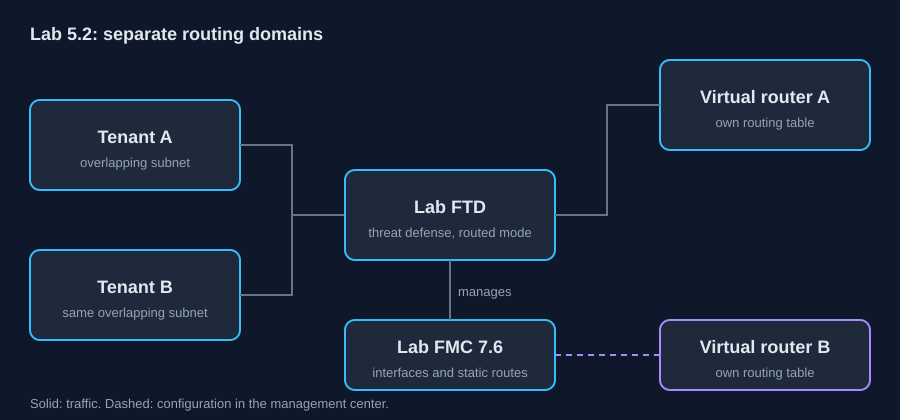

# Lab: Separate two overlapping networks with virtual routers

Video: [Virtual Routers: Separating Routing Domains](https://youtu.be/qbLnUylHp64)
Reference: Cisco Secure Firewall Management Center Device Configuration Guide 7.6,
chapter 25 (PDF pages 1225-1278). Check the guide for your exact version.

> **Use a lab FMC/FTD or a virtual lab, never production.**

## Goal

Keep two routing domains that use the same private subnet fully apart on one firewall. You create two user-defined virtual routers, give each an inside interface with the same subnet on purpose, compare their routing tables, and prove that traffic cannot cross without explicit route leaking.

## Background

- Mergers, acquisitions and multi-tenant designs often bring identical private subnets. One routing table cannot hold two different paths to the same prefix, so traffic is dropped or misrouted. Virtual routers let a single firewall keep those routing domains separate instead of adding hardware.
- Each virtual router keeps its own independent routing table. Traffic in one virtual router cannot see routes in another. The global virtual router exists by default; user-defined virtual routers are created by you. Routes are shared between them only through explicit route leaking.
- Guidelines from the documentation: virtual routers are supported in routed firewall mode only. User-defined virtual routers support only BGP (IPv4/IPv6) and OSPFv2 as routing protocols. EtherChannel member, redundant member and BVI member interfaces cannot be assigned to a user-defined virtual router. ECMP zones are configured per virtual router.

## Prerequisites

- A lab management center and a lab threat defense in routed mode (never production).
- Two spare data interfaces and two lab routers or hosts for the two tenants.

Values you will use (keep them as placeholders in anything you share, never commit real values):

| Placeholder | What it is |
|---|---|
| `<VR_A>` | name of the first virtual router |
| `<VR_B>` | name of the second virtual router |
| `<INSIDE_A>` | inside interface for tenant A |
| `<INSIDE_B>` | inside interface for tenant B |
| `<OVERLAP_SUBNET>` | the subnet both tenants use on purpose |
| `<NEXT_HOP_A>` | next hop for tenant A |
| `<NEXT_HOP_B>` | next hop for tenant B |
| `<SERVER_NET_B>` | a network that exists only behind tenant B |

## Steps

### Part 1: build the domains

1. Confirm the device is in routed mode and healthy (Devices > Device Management).
2. On the device Routing page create `<VR_A>` and `<VR_B>`, assign `<INSIDE_A>` to the first and `<INSIDE_B>` to the second, both using `<OVERLAP_SUBNET>`.
3. Add a static default route inside each virtual router toward `<NEXT_HOP_A>` and `<NEXT_HOP_B>`. Deploy.

### Part 2: compare

4. On the device CLI run `show route vrf <VR_A>` and `show route vrf <VR_B>` and compare the two tables.
5. Run `show route` and confirm the global virtual router does not contain the overlapping prefix.

### Part 3: prove the separation

6. From a host in tenant A try to reach `<SERVER_NET_B>` and confirm it fails without route leaking.

## Where this lab follows the documentation

To verify a user-defined virtual router use `show route vrf <name>`, and `show route` for the global virtual router. The command `show network-static-routes` shows static routes for the management interface only, so it cannot confirm data-plane virtual router routing. Check the virtual router guidelines for your exact release for any feature limitations.

## Check your work

Use [checklist.md](checklist.md). If something does not work, start with
[troubleshooting.md](troubleshooting.md).

## Clean up

Remove the user-defined virtual routers and reassign the interfaces, then deploy again.

---
*Always confirm behavior against the guide for your exact FMC/FTD version. Independent training by Hexward Labs; not affiliated with or endorsed by Cisco Systems.*
