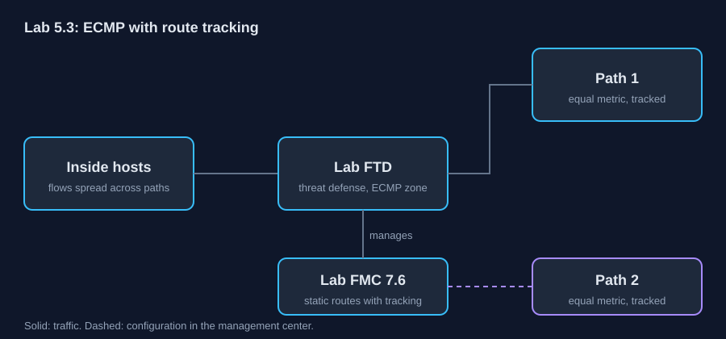

# Lab: Two equal-cost default routes with tracking

Video: [ECMP and BFD: Parallel Paths and Failure Detection](https://youtu.be/YFQE2t-KylA)
Reference: Cisco Secure Firewall Management Center Device Configuration Guide 7.6,
chapters 26-27 (PDF pages 1281-1296). Check the guide for your exact version.

> **Use a lab FMC/FTD or a virtual lab, never production.**

## Goal

Use both uplinks and remove a dead one quickly. You build an ECMP zone with two equal-metric default routes, add route tracking to each, then break one tracked path and watch the routing table drop it.

## Background

- Many sites pay for two uplinks and use only one. When a failure is silent (the cable stays up but the path behind it is dead) the firewall keeps sending traffic into a black hole. ECMP lets both paths carry traffic; route tracking or BFD removes a dead path quickly.
- ECMP applies only when several routes to the same destination have the same metric. A route with metric 10 and another with metric 11 are not equal; everything goes to the metric-10 path.
- A stateful firewall must keep each connection on one path. The documentation describes load balancing by a hash of the source and destination addresses, incoming interface, protocol and ports, so packets of one flow stay together while different flows are spread across paths.
- ECMP zone guidelines: routed mode only; configured on the Routing page under the virtual router's ECMP tab; routed interfaces only (not BVI, management, failover/state, cluster control link, VNI or VLAN interfaces; no dVTI or loopback); up to 8 interfaces per zone and an interface belongs to only one zone.
- Detecting a dead path: route tracking (SLA monitor) sends ICMP probes toward a target and removes the tracked static route when probes fail. BFD is a lightweight hello protocol that detects failure much faster than routing protocol timers; check the BFD chapter for what your release supports.

## Prerequisites

- A lab management center and a lab threat defense in routed mode with two working outside interfaces (never production).
- A reliable reachable target beyond each next hop that you can later block in the lab.

Values you will use (keep them as placeholders in anything you share, never commit real values):

| Placeholder | What it is |
|---|---|
| `<OUTSIDE_1>` | first outside interface |
| `<OUTSIDE_2>` | second outside interface |
| `<ZONE_NAME>` | name of the ECMP zone |
| `<NEXT_HOP_1>` | next hop on the first path |
| `<NEXT_HOP_2>` | next hop on the second path |
| `<TARGET_1>` | tracking target beyond the first next hop |
| `<TARGET_2>` | tracking target beyond the second next hop |

## Steps

### Part 1: ECMP zone and routes

1. Confirm routed mode and two working outside interfaces with `show interface ip brief`.
2. On the Routing page open the virtual router's ECMP tab, add `<ZONE_NAME>` and include `<OUTSIDE_1>` and `<OUTSIDE_2>`.
3. Add two default static routes (any-ipv4), one per interface toward `<NEXT_HOP_1>` and `<NEXT_HOP_2>`, with identical metrics. Enable route tracking on each toward `<TARGET_1>` and `<TARGET_2>`.

### Part 2: verify

4. Deploy, then run `show route`: you should see two equal default entries.
5. Run `show sla monitor operational-state` to see the tracking results.

### Part 3: break a path

6. Make one tracked target unreachable (for example block it upstream in the lab) and run `show route` again. Only one default route should remain.
7. Run `packet-tracer ... detailed` for two different flows and note which egress interface each uses.

## Check your work

Use [checklist.md](checklist.md). If something does not work, start with
[troubleshooting.md](troubleshooting.md).

## Clean up

Remove the tracking, the extra default route and the ECMP zone, then deploy again.

---
*Always confirm behavior against the guide for your exact FMC/FTD version. Independent training by Hexward Labs; not affiliated with or endorsed by Cisco Systems.*
