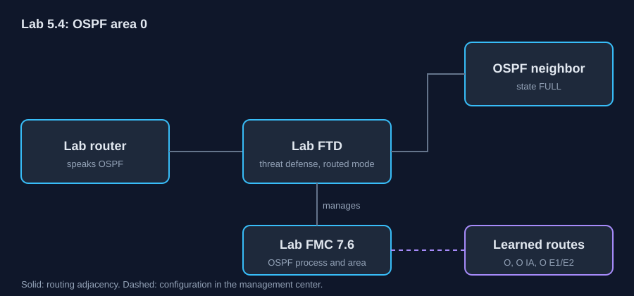

# Lab: Bring the firewall into OSPF area 0

Video: [OSPFv2: Configuration and Verification Points](https://youtu.be/FVp13Y67kdI)
Reference: Cisco Secure Firewall Management Center Device Configuration Guide 7.6,
chapter 28 (PDF pages 1297-1314). Check the guide for your exact version.

> **Use a lab FMC/FTD or a virtual lab, never production.**

## Goal

Make the firewall part of the routing picture. You enable an OSPF process, define area 0, add the interface network that faces your lab router, deploy, and confirm a FULL neighbor and the expected route codes.

## Background

- A firewall with perfect access rules can still isolate the network if it is not part of the routing picture. With only static routes, any topology change can leave it pointing to a path that no longer exists. Running OSPF lets it adapt to changes like the routers around it.
- An OSPF area is a logical group of routers, links and networks that share the same link-state information. On threat defense, areas give you separation of routing domains, control over redistribution, summary address ranges, inter-area filtering and virtual links when an area does not touch backbone area 0.
- Before you configure: routed firewall mode (OSPF does not support transparent mode); correct interface addressing with no overlapping subnets; and, for HA pairs, the same software version and the same NTP source.
- Route codes in `show route`: O is an intra-area route, O IA an inter-area route, O E1 and O E2 external routes redistributed from another source.

## Prerequisites

- A lab management center and a lab threat defense in routed mode (never production).
- A lab router that speaks OSPF on the connected link.

Values you will use (keep them as placeholders in anything you share, never commit real values):

| Placeholder | What it is |
|---|---|
| `<PROCESS_ID>` | the OSPF process ID |
| `<AREA_ID>` | the OSPF area (area 0 in this lab) |
| `<LAB_INTERFACE>` | the interface facing the lab router |
| `<LAB_NETWORK>` | the network on that interface |
| `<SUMMARY_RANGE>` | an optional summary range |

## Steps

### Part 1: prepare

1. Confirm routed mode and correct interface addressing with `show interface ip brief`.

### Part 2: configure

2. In the management center open Devices > Device Management, edit the device and open Routing > OSPF.
3. Enable process `<PROCESS_ID>`, define area `<AREA_ID>` and add `<LAB_NETWORK>` on `<LAB_INTERFACE>`.
4. Optionally add `<SUMMARY_RANGE>` or an inter-area filter to see its effect.
5. Preview the changes and deploy. Nothing happens on the device until you deploy.

### Part 3: verify

6. On the device CLI run `show ospf neighbor` and `show route`.

## Where this lab follows the documentation

OSPF does not support transparent firewall mode; the device must be in routed mode to run OSPF. A static MAC entry for an HSRP router applies when a transparent firewall sits between routers; it is not an OSPF setting on the firewall. The current guidelines state that OSPFv2 and OSPFv3 support stateful high availability, so test failover in your lab instead of assuming manual steps are needed.

## Check your work

Use [checklist.md](checklist.md). If something does not work, start with
[troubleshooting.md](troubleshooting.md).

## Clean up

Remove the OSPF process and the lab summary or filter, then deploy again.

---
*Always confirm behavior against the guide for your exact FMC/FTD version. Independent training by Hexward Labs; not affiliated with or endorsed by Cisco Systems.*
