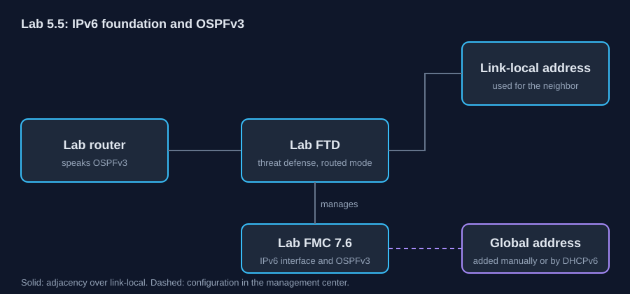

# Lab: Build the IPv6 foundation, then OSPFv3

Video: [OSPFv3 for IPv6 Networks](https://youtu.be/_8D4-ga0MIo)
Reference: Cisco Secure Firewall Management Center Device Configuration Guide 7.6,
chapter 28 (PDF pages 1315-1326). Check the guide for your exact version.

> **Use a lab FMC/FTD or a virtual lab, never production.**

## Goal

Understand that OSPFv3 depends on a correct IPv6 foundation. You enable IPv6 on an interface and see that only a link-local address exists, add a global address, configure OSPFv3 for area 0, and verify the neighbor and routes.

## Background

- OSPFv3 is not OSPFv2 with longer addresses. It forms neighbors over IPv6 link-local addresses, per link. If the IPv6 foundation on an interface is incomplete or broken, OSPFv3 never forms an adjacency even though the configuration looks finished.
- OSPFv2 runs on IPv4 subnets and network statements; OSPFv3 runs per link, enabled on interfaces, and uses link-local addresses for neighbors.
- IPv6 interface basics: Enable IPv6 (interface > IPv6 tab) turns on IPv6 processing and creates the link-local address only; it does not give the interface a global address. Add a global address manually or use dynamic options such as DHCPv6 prefix delegation.
- Neighbor Discovery replaces ARP and uses ICMPv6 Neighbor Solicitation (type 135) and Neighbor Advertisement (type 136). For bridge groups in transparent mode the documentation requires an access rule that permits these messages.
- Duplicate Address Detection checks that an address is unique before use. A duplicate generates syslog 325002; if the duplicate is the link-local address, IPv6 processing is disabled on that interface and OSPFv3 on that link stops completely.

## Prerequisites

- A lab management center and a lab threat defense in routed mode (never production).
- A lab router that speaks OSPFv3 on the connected link.

Values you will use (keep them as placeholders in anything you share, never commit real values):

| Placeholder | What it is |
|---|---|
| `<LAB_INTERFACE>` | the interface facing the lab router |
| `<GLOBAL_IPV6>` | a global IPv6 address from the documentation range |
| `<AREA_ID>` | the OSPFv3 area (area 0 in this lab) |

## Steps

### Part 1: IPv6 foundation

1. Confirm routed mode.
2. Edit `<LAB_INTERFACE>`, open the IPv6 tab, check Enable IPv6, deploy and run `show ipv6 interface brief`. Note that only a link-local address exists.
3. Add `<GLOBAL_IPV6>` and deploy again.

### Part 2: OSPFv3

4. Configure OSPFv3 (Routing > OSPFv3) for `<LAB_INTERFACE>` and area `<AREA_ID>`, matching the lab router. Deploy.

### Part 3: verify

5. Run `show ipv6 ospf neighbor` and `show ipv6 route`.

## Where this lab follows the documentation

The commands shown in the video (`configure network ipv6 manual ...` on the threat defense CLI and `scope ...` / `set out-of-band static ipv6 ...` on the FXOS chassis CLI) configure management-interface IPv6 addressing; they do not verify data-interface IPv6 or OSPFv3. To check OSPFv3 on the data plane use `show ipv6 interface brief`, `show ipv6 ospf neighbor` and `show ipv6 route`. OSPF (v2 and v3) runs only in routed firewall mode.

## Check your work

Use [checklist.md](checklist.md). If something does not work, start with
[troubleshooting.md](troubleshooting.md).

## Clean up

Remove the OSPFv3 configuration and the lab IPv6 address, then deploy again.

---
*Always confirm behavior against the guide for your exact FMC/FTD version. Independent training by Hexward Labs; not affiliated with or endorsed by Cisco Systems.*
