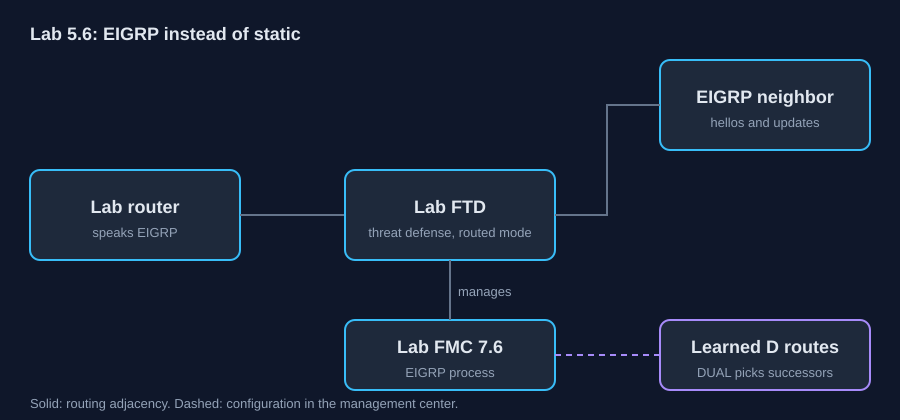

# Lab: Replace a static route with EIGRP

Video: [EIGRP on FTD | Cisco Secure Firewall](https://youtu.be/ddyNKlH6jjk)
Reference: Cisco Secure Firewall Management Center Device Configuration Guide 7.6,
chapter 29 (PDF pages 1327-1336). Check the guide for your exact version.

> **Use a lab FMC/FTD or a virtual lab, never production.**

## Goal

Let the firewall react to a path failure by itself. You enable EIGRP with the lab AS number, confirm the neighbor and D routes, shut the primary path on the lab router, watch the route table change, and only then remove the static route.

## Background

- A static route does not know whether its path still works. When a link fails, traffic keeps going into a black hole until someone changes the route by hand. EIGRP exchanges updates with neighbors and moves traffic to another path when a neighbor or route is lost; backup paths are computed by DUAL.
- EIGRP guidelines on threat defense: routed firewall mode only; one EIGRP process per device; IPv4 only; interfaces from the global virtual router only. Supported interface types include physical, EtherChannel, redundant and subinterfaces; EtherChannel member interfaces are not supported. When redistributing between EIGRP and OSPF, configure route tagging to avoid loops.
- HA reminder (a separate topic): both units need the same software version and NTP configuration, no uncommitted changes in the management center, and no DHCP or PPPoE addressing on any interface before you can form the pair.
- Route codes in `show route`: D is an EIGRP internal route and D EX an EIGRP external route redistributed into EIGRP.

## Prerequisites

- A lab management center and a lab threat defense in routed mode (never production).
- A lab router that speaks EIGRP and has two paths you can shut one at a time.

Values you will use (keep them as placeholders in anything you share, never commit real values):

| Placeholder | What it is |
|---|---|
| `<AS_NUMBER>` | the lab EIGRP autonomous system number |
| `<LAB_INTERFACE>` | the interface facing the lab router |
| `<LAB_NETWORK>` | the network on that interface |
| `<STATIC_ROUTE>` | the old static route you will retire |

## Steps

### Part 1: configure

1. Confirm routed mode and addressing with `show interface ip brief`.
2. Edit the device, open Routing > EIGRP, enable EIGRP with `<AS_NUMBER>` and add `<LAB_NETWORK>` on `<LAB_INTERFACE>`.

### Part 2: verify

3. Deploy, then run `show eigrp neighbors` and `show eigrp topology`.
4. Run `show route` and find the D routes learned from the lab router.

### Part 3: failure and cleanup

5. Shut the primary path on the lab router side and run `show route` again to see the change.
6. Run `packet-tracer ... detailed` for a test flow and confirm it follows the remaining path.
7. Remove `<STATIC_ROUTE>` only after the EIGRP routes are confirmed.

## Where this lab follows the documentation

The video predicts that leaving DHCP on one interface of an HA pair makes an EIGRP adjacency fail silently. No DHCP or PPPoE addressing on any interface is a prerequisite for forming a high-availability pair, not an EIGRP mechanism; the management center checks HA prerequisites when you create the pair. If an EIGRP neighbor does not form, check the usual causes: routed mode, matching AS number, interfaces in the EIGRP process and reachability.

## Check your work

Use [checklist.md](checklist.md). If something does not work, start with
[troubleshooting.md](troubleshooting.md).

## Clean up

Remove the EIGRP configuration and restore the lab static route if needed, then deploy again.

---
*Always confirm behavior against the guide for your exact FMC/FTD version. Independent training by Hexward Labs; not affiliated with or endorsed by Cisco Systems.*
