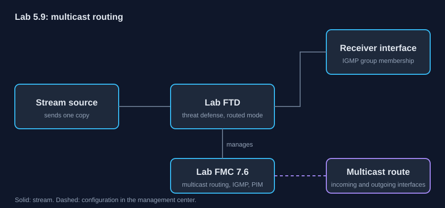

# Lab: Route one multicast group through the firewall

Video: [Multicast Routing on the Firewall](https://youtu.be/K9z-TIDQaxg)
Reference: Cisco Secure Firewall Management Center Device Configuration Guide 7.6,
chapter 32 (PDF pages 1363-1382). Check the guide for your exact version.

> **Use a lab FMC/FTD or a virtual lab, never production.**

## Goal

Send one stream instead of one copy per viewer. You enable multicast routing on routed interfaces, review IGMP on the receiver side and PIM on the source side, allow the traffic, and verify the group with the multicast show commands.

## Background

- A live video sent as unicast means one copy per viewer, so a thousand viewers become a thousand identical streams through the firewall. Multicast sends one stream and lets the network replicate it only where receivers have asked for it, but the firewall must be configured to route it.
- IGMP lets hosts tell their local router that they want a group; configure it on interfaces facing receivers. PIM lets routers build the distribution tree back toward the source without loops; configure it on interfaces facing the routed network and the source.
- Limitations: multicast routing requires routed interfaces. Bridge virtual interfaces and bridge groups do not support it. In transparent mode the firewall cannot route multicast; it can only pass it through when an access rule permits it.
- Clustering: the control unit handles multicast routing packets (IGMP and PIM) and data packets until fast-path forwarding is established; afterwards each data unit can forward multicast data packets, so the control unit is not the bottleneck.

## Prerequisites

- A lab management center and a lab threat defense in routed mode (never production).
- A test stream source (for example a media player) and a receiver on the other side.

Values you will use (keep them as placeholders in anything you share, never commit real values):

| Placeholder | What it is |
|---|---|
| `<SOURCE_INTERFACE>` | the routed interface facing the source |
| `<RECEIVER_INTERFACE>` | the routed interface facing the receiver |
| `<TEST_GROUP>` | a multicast group address for the lab |
| `<ACP_NAME>` | the lab access control policy |

## Steps

### Part 1: enable

1. Confirm routed mode and that `<SOURCE_INTERFACE>` and `<RECEIVER_INTERFACE>` are routed interfaces, not BVIs.
2. Edit the device, open Routing > Multicast Routing and enable it.
3. Review IGMP on `<RECEIVER_INTERFACE>` and PIM on `<SOURCE_INTERFACE>`. Deploy.

### Part 2: allow and test

4. Allow the multicast traffic in `<ACP_NAME>`.
5. Start a test stream to `<TEST_GROUP>` and join it from a receiver.

### Part 3: verify

6. On the device CLI run `show igmp groups`, `show pim neighbor` and `show mroute`.

## Check your work

Use [checklist.md](checklist.md). If something does not work, start with
[troubleshooting.md](troubleshooting.md).

## Clean up

Disable multicast routing for the lab and remove the lab access rule, then deploy again.

---
*Always confirm behavior against the guide for your exact FMC/FTD version. Independent training by Hexward Labs; not affiliated with or endorsed by Cisco Systems.*
