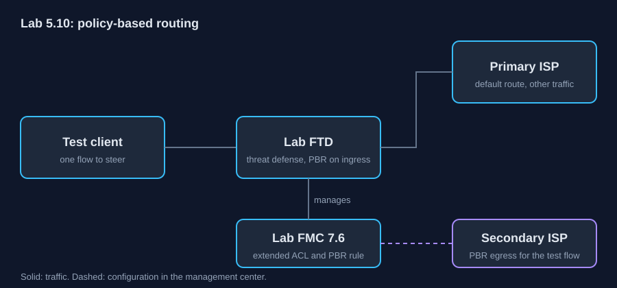

# Lab: Steer one flow with policy-based routing

Video: [Policy-Based Routing and Path Monitoring](https://youtu.be/YdlVAOh6jnk)
Reference: Cisco Secure Firewall Management Center Device Configuration Guide 7.6,
chapter 33 (PDF pages 1383-1402). Check the guide for your exact version.

> **Use a lab FMC/FTD or a virtual lab, never production.**

## Goal

Move only specific traffic to the second link. You build a lab with two outside interfaces and a default route via the primary ISP, create PBR that sends one test flow out the secondary ISP, prove it with packet-tracer, then add path monitoring and a metric-based egress order.

## Background

- Changing the default route moves all traffic, which can overload a smaller or metered link. Policy-based routing decides by source, destination, protocol and (with applications) application, using an extended ACL, and is applied to ingress traffic before the normal routing decision.
- Prerequisites: routed mode; egress interfaces configured and up (routed interfaces in the global virtual router); the normal routing, for example the default route, already in place. PBR is an ingress-only feature and uRPF must be disabled on interfaces where PBR is used.
- When a PBR rule lists more than one egress interface, the device can order them by interface priority or by path monitoring metrics: minimal jitter, minimal round-trip time, minimal packet loss or maximum MOS.
- Application-based PBR matches predefined applications in the extended ACL and relies on DNS snooping, so clients must use trusted DNS servers with clear-text DNS. The predefined list cannot be changed, and application-, user- and SGT-based PBR are not supported on cluster devices.
- Path monitoring is enabled on the interface and probes the next hop or a peer address you choose, feeding metrics to PBR. If traffic arrives before metrics are available, the routing table decides the path.

## Prerequisites

- A lab management center and a lab threat defense in routed mode with two outside interfaces simulating two ISPs (never production).
- A test client and one test destination.

Values you will use (keep them as placeholders in anything you share, never commit real values):

| Placeholder | What it is |
|---|---|
| `<INSIDE_INTERFACE>` | the interface where traffic enters |
| `<ISP_A_INTERFACE>` | the primary outside interface |
| `<ISP_B_INTERFACE>` | the secondary outside interface |
| `<CLIENT_IP>` | the test client |
| `<TEST_DESTINATION>` | the test destination |
| `<PBR_ACL>` | the extended ACL that matches only the test flow |

## Steps

### Part 1: PBR for one flow

1. Build the lab with `<ISP_A_INTERFACE>` and `<ISP_B_INTERFACE>` and a default route via the primary ISP.
2. Create `<PBR_ACL>` matching traffic from `<CLIENT_IP>` to `<TEST_DESTINATION>` only.
3. Configure PBR on `<INSIDE_INTERFACE>`: match `<PBR_ACL>`, egress `<ISP_B_INTERFACE>`. Deploy.
4. Run `packet-tracer` for the test flow and confirm the egress is `<ISP_B_INTERFACE>`; run it for other traffic and confirm it still uses the default route.

### Part 2: path monitoring

5. Enable path monitoring on both outside interfaces, add `<ISP_A_INTERFACE>` as a second egress, choose a metric-based order and deploy.

### Part 3: failure

6. Degrade or shut the secondary path and observe which interface the test flow uses with `show conn` and the connection events.

## Where this lab follows the documentation

On threat defense, path monitoring is enabled per interface (interface Path Monitoring tab: monitoring type and, optionally, the peer address to monitor) and its timers are fixed: ICMP probes every second, with metrics averaged and updated every 30 seconds. The documentation states these intervals cannot be configured. PBR uses the collected metrics (round-trip time, jitter, packet loss, MOS) to choose the best egress interface. A configurable frequency and threshold belong to static route tracking (SLA monitor), a different feature.

## Check your work

Use [checklist.md](checklist.md). If something does not work, start with
[troubleshooting.md](troubleshooting.md).

## Clean up

Remove the PBR rule, the lab ACL and path monitoring, then deploy again.

---
*Always confirm behavior against the guide for your exact FMC/FTD version. Independent training by Hexward Labs; not affiliated with or endorsed by Cisco Systems.*
