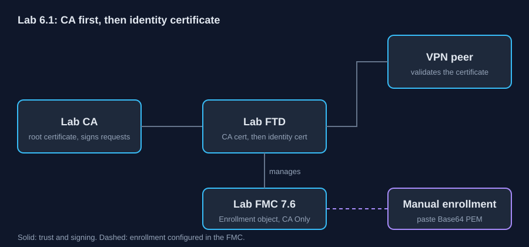

# Lab: Install trust before identity, CA and identity certificates

Video: [Certificates and PKI Before VPN Configuration](https://youtu.be/FJkeLd4PbO4)
Reference: Cisco Secure Firewall Management Center Device Configuration Guide 7.6,
chapters 34-35 (PDF pages 1457-1473 and 1537-1546). Check the guide for your exact version.

> **Use a lab FMC/FTD or a virtual lab, never production, and a lab certificate authority.**

## Goal

Get the certificate order right before any VPN depends on it. You install a lab CA certificate as a trusted CA, check it on the device, enroll an identity certificate signed by that CA, and optionally watch an identity certificate fail without its CA.

## Background

- Nothing is trusted by default. The CA (root) certificate must be installed on the firewall before any identity certificate signed by that CA can be validated.
- The identity certificate is the firewall's own ID, signed by the CA. If the CA certificate is not present to verify the signature, the identity certificate is rejected.
- For manual import, the CA certificate must be Base64-encoded PEM text (it starts with the BEGIN CERTIFICATE line). A binary DER file will not paste into the manual enrollment text box.
- In the certificate enrollment object, choose Manual enrollment and check CA Only when you only want to install the trusted CA.

## Prerequisites

- A lab management center and threat defense (7.6 or your version).
- A lab CA you control, able to export its root certificate in Base64 PEM and to sign a request.
- Optionally, a second lab device for the failure test.

Values you will use (keep them as placeholders in anything you share, never commit real values):

| Placeholder | What it is |
|---|---|
| `<LAB_CA>` | your lab certificate authority |
| `<CA_CERT_PEM>` | the lab CA root certificate in Base64 PEM format |
| `<DEVICE_NAME>` | the lab device that receives the certificates |
| `<TRUSTPOINT_NAME>` | name of the certificate enrollment object |

## Steps

### Part 1: the trusted CA

1. Export the root certificate of `<LAB_CA>` as Base64 PEM (`<CA_CERT_PEM>`).
2. In the management center, add a certificate to `<DEVICE_NAME>` (Devices > Certificates; menu paths vary by version) using a new enrollment object `<TRUSTPOINT_NAME>` with **Manual** enrollment and **CA Only** checked. Paste the CA certificate and deploy if prompted.
3. On the device CLI run `show crypto ca certificates` and confirm the CA certificate status is **Available**. Note its usage and validity dates.

### Part 2: the identity certificate

4. Enroll an identity certificate for `<DEVICE_NAME>` signed by the same CA (for example by generating a certificate signing request and importing the signed result).
5. Run `show crypto ca certificates` again and confirm both the CA and the identity certificate are present and valid.

### Part 3: break it on purpose (optional)

6. On a second test device, try to import the identity certificate without installing the CA first and note the failure. Install the CA, then import again.

## Check your work

Use [checklist.md](checklist.md). If something does not work, start with
[troubleshooting.md](troubleshooting.md).

## Clean up

Remove the lab enrollment objects and certificates from the lab device, and delete any test certificate files you exported.

---
*Always confirm behavior against the guide for your exact FMC/FTD version. Independent training by Hexward Labs; not affiliated with or endorsed by Cisco Systems.*
