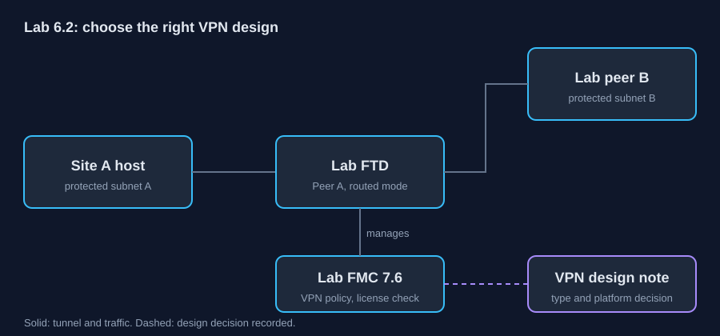

# Lab: Pick the right design, site-to-site or remote access, and the platform

Video: [FTD VPNs: Site-to-Site or Remote Access?](https://youtu.be/sgVSWo46yb8)
Reference: Cisco Secure Firewall Management Center Device Configuration Guide 7.6,
chapter 36 (PDF pages 1549-1562). Check the guide for your exact version.

> **Use a lab FMC/FTD or a virtual lab, never production.**

## Goal

Choose the VPN type and the platform together. You confirm licensing and routed mode, build a simple point-to-point site-to-site tunnel, check it from the CLI, and write a one-page design note about where remote access terminates.

## Background

- Site-to-site VPN connects networks to networks with an always-on tunnel between fixed peers. Remote access connects individual endpoints on demand, using connection profiles, group policies, access rules and Cisco Secure Client.
- Prerequisites for both: export-controlled licensing for strong encryption, named routed interfaces (for example inside and outside) with correct routing, and IKE and IPsec settings planned in advance.
- A transparent (Layer 2) firewall supports site-to-site VPN only for management connections to the device on bridge group member interfaces. It does not terminate VPN traffic passing through it. Use routed mode.
- In a cluster, site-to-site VPN is centralized on the control node, and existing VPN connections drop on control-node failover. Remote access VPN is not supported on clusters.

## Prerequisites

- Two lab devices managed by a lab management center (7.6 or your version), in routed mode.
- A routed path between the two lab outside interfaces and one protected subnet on each side.

Values you will use (keep them as placeholders in anything you share, never commit real values):

| Placeholder | What it is |
|---|---|
| `<PEER_A_NAME>` | first lab device |
| `<PEER_B_NAME>` | second lab device |
| `<SUBNET_A>` | protected subnet behind peer A |
| `<SUBNET_B>` | protected subnet behind peer B |
| `<PSK>` | lab pre-shared key; use a throwaway value and never commit it |

## Steps

### Part 1: prerequisites

1. In the management center confirm the smart license allows export-controlled functionality.
2. Confirm both devices are in routed mode, with named `inside` and `outside` interfaces and routes toward the peer networks.

### Part 2: a simple tunnel

3. Build a point-to-point site-to-site VPN between `<PEER_A_NAME>` and `<PEER_B_NAME>` protecting `<SUBNET_A>` and `<SUBNET_B>`, using `<PSK>`. Deploy to both.
4. Send traffic between the protected networks and, on the device CLI, check the tunnel with `show crypto ipsec sa` and the sessions with `show vpn-sessiondb`.

### Part 3: the design note

5. Write a one-page note: where remote access VPN will terminate in your design, and why not on a cluster or a transparent firewall. Include what happens to site-to-site VPN when a cluster control node fails.

## Check your work

Use [checklist.md](checklist.md). If something does not work, start with
[troubleshooting.md](troubleshooting.md).

## Clean up

Remove the lab VPN topology and any lab keys, then deploy to both devices.

---
*Always confirm behavior against the guide for your exact FMC/FTD version. Independent training by Hexward Labs; not affiliated with or endorsed by Cisco Systems.*
