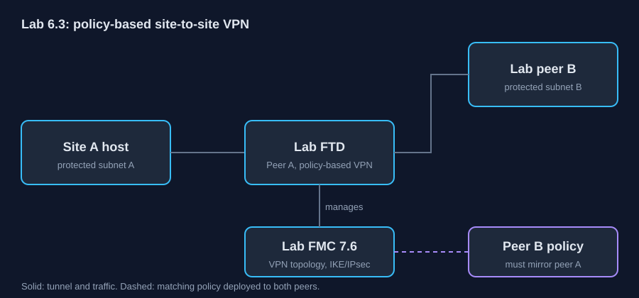

# Lab: Policy-based site-to-site VPN, break and fix a proposal

Video: [Policy-Based Site-to-Site VPN](https://youtu.be/uzTQBjUM9gc)
Reference: Cisco Secure Firewall Management Center Device Configuration Guide 7.6,
chapter 37 (PDF pages 1563-1581). Check the guide for your exact version.

> **Use a lab FMC/FTD or a virtual lab, never production.**

## Goal

Learn why branches go dark: one mismatched parameter. You build a policy-based point-to-point VPN, confirm it is up, change the IKE encryption on one peer only, watch it fail, find the mismatch in the VPN troubleshooting logs, and restore it.

## Background

- In a policy-based VPN the tunnel protects traffic between explicitly defined protected networks, within a topology such as point-to-point or hub-and-spoke. It does not use a tunnel interface and the routing table to decide what is encrypted.
- Draw the topology first: which subnets on each site must reach each other. That map becomes the protected networks and the access policy that permits tunnel traffic.
- Devices must be registered with the management center over the encrypted management channel; without working registration you cannot deploy VPN policy.
- Phase 1 (IKE) and phase 2 (IPsec) need at least one proposal that both sides accept. For example, a hub with AES-256 and a spoke with AES-128 only has no common proposal.
- In a cluster only the control node runs site-to-site VPN, data nodes must carry no VPN configuration, and tunnels drop on control-node failover.

## Prerequisites

- Two lab devices registered to a lab management center (7.6 or your version), with named inside and outside interfaces and IP addresses.
- One protected subnet on each side and a routed path between the outside interfaces.
- IKE and IPsec policies prepared and a lab pre-shared key.

Values you will use (keep them as placeholders in anything you share, never commit real values):

| Placeholder | What it is |
|---|---|
| `<PEER_A_NAME>` | first lab device |
| `<PEER_B_NAME>` | second lab device |
| `<SUBNET_A>` | protected subnet behind peer A |
| `<SUBNET_B>` | protected subnet behind peer B |
| `<IKE_POLICY>` | IKE policy used by both peers |
| `<PSK>` | lab pre-shared key; use a throwaway value and never commit it |

## Steps

### Part 1: build the tunnel

1. Draw a two-site topology with `<SUBNET_A>` and `<SUBNET_B>` as the protected networks.
2. Create a point-to-point policy-based site-to-site VPN with matching IKE (`<IKE_POLICY>`) and IPsec policies and `<PSK>`. Deploy to both peers.
3. Send traffic between the protected networks and confirm the tunnel with `show crypto ikev2 sa` and `show crypto ipsec sa`.

### Part 2: break it on purpose

4. Change the IKE encryption on one peer only so no proposal matches. Deploy and watch the tunnel fail.
5. Find the mismatch in the VPN troubleshooting logs in the management center. Then restore matching parameters and deploy.

## Check your work

Use [checklist.md](checklist.md). If something does not work, start with
[troubleshooting.md](troubleshooting.md).

## Clean up

Remove the lab VPN topology and the lab key, and deploy to both peers.

---
*Always confirm behavior against the guide for your exact FMC/FTD version. Independent training by Hexward Labs; not affiliated with or endorsed by Cisco Systems.*
