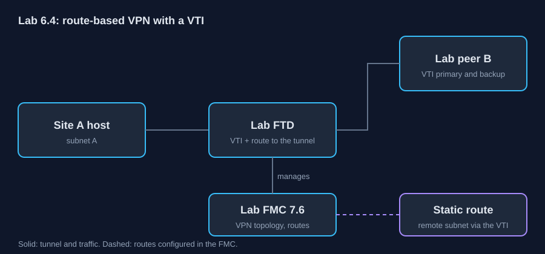

# Lab: Route-based VPN with a VTI, route into the tunnel

Video: [Route-Based VPN with VTI](https://youtu.be/a4xt_ddFoQE)
Reference: Cisco Secure Firewall Management Center Device Configuration Guide 7.6,
chapter 37 (PDF pages 1582-1606). Check the guide for your exact version.

> **Use a lab FMC/FTD or a virtual lab, never production.**

## Goal

Let routing decide what goes into the tunnel. You build a route-based VPN with a static VTI, see that a tunnel that is up does nothing without a route, add the route, add a backup VTI with a worse metric, and test large transfers for MTU problems.

## Background

- A VTI is a routable logical interface that represents the tunnel. It separates the overlay (the encrypted tunnel) from the underlay (the physical path).
- A static VTI suits known peers (point-to-point or classic hub-and-spoke). A dynamic VTI suits a hub with many spokes whose addresses are not known in advance; check the guide for its limits in your version.
- The tunnel source interface must be routed (or none): physical, subinterface, EtherChannel or loopback (supported from 7.4). Bridge groups are not supported.
- Behind a NAT or PAT router, enable the option to use the public IP address and enter the post-NAT address.
- Routing is mandatory: a tunnel that is up but has no route sends nothing through it. Use static routes or BGP or OSPF over the VTI. A backup VTI with a worse-metric route gives automatic failover.
- IPsec adds overhead. If MTU is not accounted for, large packets fragment or drop: the app connects but file transfers hang.

## Prerequisites

- Two lab devices managed by a lab management center (7.6 or your version) with a routed path between their outside interfaces.
- A protected subnet on each side, and optionally a second path for the backup VTI.

Values you will use (keep them as placeholders in anything you share, never commit real values):

| Placeholder | What it is |
|---|---|
| `<PEER_A_NAME>` | first lab device |
| `<PEER_B_NAME>` | second lab device |
| `<SUBNET_A>` | subnet behind peer A |
| `<SUBNET_B>` | subnet behind peer B |
| `<VTI_PRIMARY>` | name of the primary VTI |
| `<VTI_BACKUP>` | name of the backup VTI |
| `<PSK>` | lab pre-shared key; use a throwaway value and never commit it |

## Steps

### Part 1: tunnel without a route

1. Configure a route-based site-to-site VPN with a static VTI `<VTI_PRIMARY>` on each of `<PEER_A_NAME>` and `<PEER_B_NAME>`, using `<PSK>`. Deploy.
2. Confirm the tunnel is up with `show crypto ipsec sa`, and check the VTI with `show interface ip brief`.
3. Send traffic between `<SUBNET_A>` and `<SUBNET_B>` before adding a route. Use `packet-tracer` to see which interface it really uses.

### Part 2: route into the tunnel

4. Add a static route to the remote subnet over the VTI and deploy. Confirm with `show route` and `packet-tracer` that traffic now enters the tunnel.

### Part 3: backup and MTU

5. Add a backup VTI `<VTI_BACKUP>` and a second route with a higher metric. Disable the primary path and confirm traffic moves to the backup.
6. Test a large file transfer. If it hangs or fragments, adjust the MTU and test again.

## Check your work

Use [checklist.md](checklist.md). If something does not work, start with
[troubleshooting.md](troubleshooting.md).

## Clean up

Remove the lab VTIs, routes and VPN topology, and deploy to both devices.

---
*Always confirm behavior against the guide for your exact FMC/FTD version. Independent training by Hexward Labs; not affiliated with or endorsed by Cisco Systems.*
