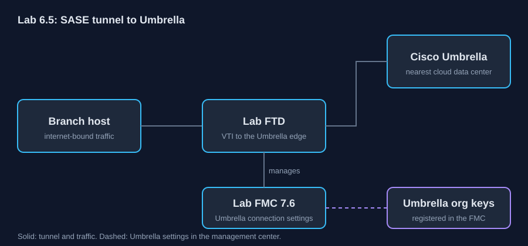

# Lab: SASE tunnel to Cisco Umbrella, build and check the cloud tunnel

Video: [SASE Integration Through Site-to-Site VPN](https://youtu.be/fWwqmqK0kx4)
Reference: Cisco Secure Firewall Management Center Device Configuration Guide 7.6,
chapter 37 (PDF pages 1607-1613). Check the guide for your exact version.

> **Use a lab FMC/FTD or a virtual lab, never production, and a lab or trial Umbrella organization.**

## Goal

Send branch internet traffic to the nearest cloud security edge instead of backhauling it. You confirm the prerequisites, enter the Umbrella connection settings, build the SASE tunnel on Umbrella, and check the VTI, the IPsec security association and the routing.

## Background

- A SASE tunnel on Umbrella is a route-based site-to-site VPN from the threat defense directly to Cisco Umbrella, built on a virtual tunnel interface (VTI).
- Documented prerequisites: a Cisco Umbrella Secure Internet Gateway (SIG) Essentials subscription; a smart license account enabled for export-controlled features (without it you can only create the SASE topology, not deploy the tunnel); Umbrella registered with the management center (management key and secret, Organization ID, Network Device Key and Secret, Legacy Network Device Token); and the Umbrella data center reachable from the threat defense.
- The workflow order is deliberate: review guidelines, confirm prerequisites, configure the Umbrella connection settings, configure the SASE tunnel, deploy and view the tunnel status.

## Prerequisites

- A lab management center and threat defense (7.6 or your version).
- A lab or trial Umbrella organization with the credentials listed above.
- Reachability from the lab device to the Umbrella data center.

Values you will use (keep them as placeholders in anything you share, never commit real values):

| Placeholder | What it is |
|---|---|
| `<UMBRELLA_ORG_ID>` | Umbrella organization ID |
| `<UMBRELLA_MGMT_KEY>` | management key (secret; never commit) |
| `<UMBRELLA_MGMT_SECRET>` | management secret (secret; never commit) |
| `<NETWORK_DEVICE_KEY>` | network device key (secret; never commit) |
| `<NETWORK_DEVICE_SECRET>` | network device secret (secret; never commit) |
| `<LEGACY_DEVICE_TOKEN>` | legacy network device token (secret; never commit) |
| `<DEVICE_NAME>` | the lab threat defense |

## Steps

### Part 1: prerequisites

1. Confirm the SIG Essentials subscription and the export-controlled licensing are in place for the lab.

### Part 2: connect Umbrella

2. Enter the Umbrella connection settings in the management center (`<UMBRELLA_ORG_ID>` and the keys above). First paste one wrong key deliberately and note the error, then correct it.

### Part 3: build and check the tunnel

3. Configure the SASE tunnel on Umbrella for `<DEVICE_NAME>` and deploy.
4. View the tunnel status in the management center.
5. On the device CLI confirm the VTI with `show interface ip brief` and the IPsec security association with `show crypto ipsec sa`.
6. Use `show route` and `packet-tracer` to confirm which traffic is routed into the tunnel.

## Where this lab follows the documentation

The video lists FMC on-premises 7.6 or later as a prerequisite. The SASE tunnel for Umbrella is not new in 7.6 and the Cisco prerequisites focus on licensing and the Umbrella connection settings, not a 7.6 minimum. Check the guide for your exact release. This lab follows the documentation.

## Check your work

Use [checklist.md](checklist.md). If something does not work, start with
[troubleshooting.md](troubleshooting.md).

## Clean up

Delete the lab SASE tunnel and the Umbrella connection settings from the management center, rotate or delete the lab Umbrella keys, and deploy again.

---
*Always confirm behavior against the guide for your exact FMC/FTD version. Independent training by Hexward Labs; not affiliated with or endorsed by Cisco Systems.*
