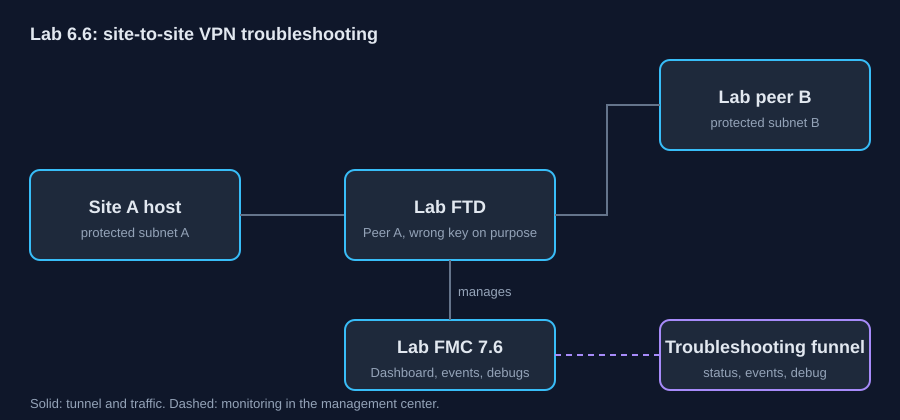

# Lab: Break and fix a tunnel, the troubleshooting funnel

Video: [Verifying and Troubleshooting Site-to-Site VPN](https://youtu.be/q6XQ12ealyk)
Reference: Cisco Secure Firewall Management Center Device Configuration Guide 7.6,
chapters 37 and 40 (PDF pages 1614-1624 and 1754-1764). Check the guide for your exact version.

> **Use a lab FMC/FTD or a virtual lab, never production.**

## Goal

Practice a fixed funnel instead of guessing. You build a working tunnel, change the pre-shared key on one side only, then go from dashboard status to VPN events to a filtered crypto debug, fix the key and verify.

## Background

- Baseline first: the IPsec configuration was actually deployed to both devices, the peers are reachable, and the management center can talk to the devices.
- The funnel: 1) check status in the VPN summary dashboard and site-to-site VPN monitoring (down or only degraded), 2) view system messages and VPN connection events to see where it failed, 3) run filtered debugs on the device CLI to see the exact mismatch.
- Debug commands include `debug crypto` for IKE and IPsec and `debug aaa` for authentication. Always filter first with `debug crypto condition peer <peer-ip>`, and stop with `undebug all`. Unfiltered debugs on a busy firewall flood the console and can lock up your session.
- Most common causes: a mismatched pre-shared key (breaks Phase 1) and MTU problems (large packets drop).

## Prerequisites

- Two lab devices registered to a lab management center (7.6 or your version).
- A working site-to-site tunnel between them, from the previous labs.

Values you will use (keep them as placeholders in anything you share, never commit real values):

| Placeholder | What it is |
|---|---|
| `<PEER_A_NAME>` | first lab device |
| `<PEER_B_NAME>` | second lab device |
| `<PEER_IP>` | the other peer's outside IP address |
| `<SUBNET_A>` | protected subnet behind peer A |
| `<SUBNET_B>` | protected subnet behind peer B |
| `<PSK>` | lab pre-shared key; use a throwaway value and never commit it |

## Steps

### Part 1: baseline

1. Build or reuse a working site-to-site tunnel between `<PEER_A_NAME>` and `<PEER_B_NAME>` and confirm it passes traffic.

### Part 2: break it

2. Change `<PSK>` on one side only and deploy.

### Part 3: the funnel

3. Check the dashboard status, then the VPN connection events, and note the first failure event.
4. On the CLI set `debug crypto condition peer <PEER_IP>`, run the crypto debug, and find the key error. Stop with `undebug all`.

### Part 4: fix and verify

5. Fix the key, deploy, and confirm with `show crypto ipsec sa` and `show vpn-sessiondb l2l`.
6. Send traffic between `<SUBNET_A>` and `<SUBNET_B>` and confirm the encrypt and decrypt counters increase.

## Check your work

Use [checklist.md](checklist.md). If something does not work, start with
[troubleshooting.md](troubleshooting.md).

## Clean up

Remove the lab tunnel and key if you no longer need them, and make sure no debug is left running (`undebug all`).

---
*Always confirm behavior against the guide for your exact FMC/FTD version. Independent training by Hexward Labs; not affiliated with or endorsed by Cisco Systems.*
