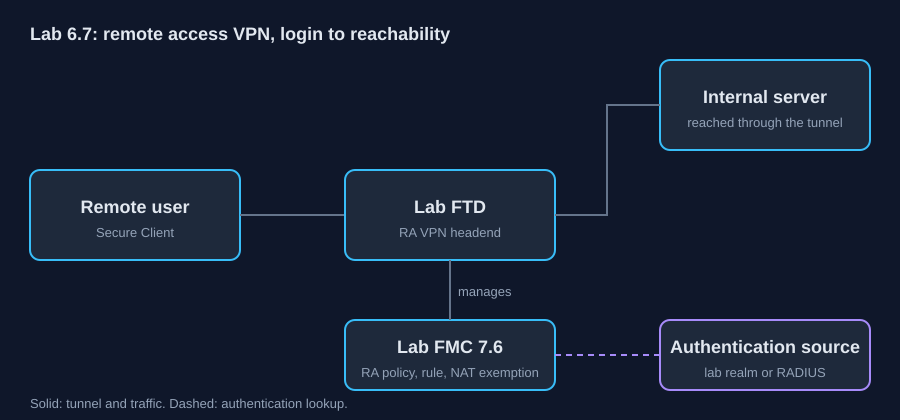

# Lab: Remote access VPN, from login to reachability

Video: [Remote Access VPN: Preparation and Basic Configuration](https://youtu.be/l4d26d7S59M)
Reference: Cisco Secure Firewall Management Center Device Configuration Guide 7.6,
chapter 38 (PDF pages 1625-1646). Check the guide for your exact version.

> **Use a lab FMC/FTD or a virtual lab, never production.**

## Goal

See why a user can authenticate and still reach nothing. You build a basic remote access VPN policy, connect a lab client, add the access control rule, and, if replies still fail, add an identity NAT exemption.

## Background

- Prerequisites per the guide: export-controlled licensing plus a Secure Client license (Advantage, Premier or VPN Only); a certificate enrollment object for each VPN gateway; Secure Client image files uploaded (Objects > VPN > Secure Client File) and a Secure Client profile (XML, from the Profile Editor); AD/LDAP realms or RADIUS servers reachable from the device; a security zone or interface group for the access interface; and address pools.
- The connection profile is the front door: it binds the authentication method, address assignment and group policy. It gets users authenticated and addressed, but it does not authorize access to internal resources.
- Update the access control policy to allow VPN users' traffic, for example source zone outside, source network the VPN pool, destination zone inside, action Allow.
- If the device has a broad inside-to-outside dynamic PAT rule, server replies to the VPN pool can match it and be translated. A NAT exemption (manual static NAT with the same object as original and translated source and destination) keeps the original addresses.

## Prerequisites

- A lab management center and threat defense (7.6 or your version) in routed mode.
- The prerequisites above in place, and a lab client with Cisco Secure Client.
- An internal lab server to test reachability.

Values you will use (keep them as placeholders in anything you share, never commit real values):

| Placeholder | What it is |
|---|---|
| `<VPN_FQDN>` | the name clients connect to |
| `<VPN_POOL>` | address pool for VPN clients |
| `<INSIDE_SUBNET>` | internal subnet the VPN users should reach |
| `<OUTSIDE_ZONE>` | security zone of the VPN access interface |
| `<AUTH_REALM>` | lab realm or RADIUS group used for authentication |
| `<TEST_USER>` | a lab user |
| `<INTERNAL_SERVER>` | lab server for the reachability test |

## Steps

### Part 1: build the policy

1. Check the prerequisites: license, certificate enrollment, Secure Client image, `<AUTH_REALM>`, and the pool `<VPN_POOL>`.
2. Build the RA VPN policy (Devices > VPN > Remote Access; menu paths vary by version) and deploy it **without** the access rule and the NAT exemption.
3. Connect a lab client as `<TEST_USER>` to `<VPN_FQDN>`. Expect it to authenticate but not reach `<INTERNAL_SERVER>`.

### Part 2: access control

4. Add an access control rule: source zone `<OUTSIDE_ZONE>`, source network `<VPN_POOL>`, destination `<INSIDE_SUBNET>`, action Allow. Deploy and test again.

### Part 3: NAT exemption

5. If replies still fail, add a manual static NAT rule inside to outside with `<INSIDE_SUBNET>` and `<VPN_POOL>` mapped to themselves (original and translated objects identical). Deploy and test again.
6. Run `packet-tracer` from the inside interface toward a pool address to see which NAT rule matches, and check `show nat detail`.
7. Confirm the session with `show vpn-sessiondb anyconnect`.

## Check your work

Use [checklist.md](checklist.md). If something does not work, start with
[troubleshooting.md](troubleshooting.md).

## Clean up

Delete the lab RA VPN policy, the access rule and the NAT exemption, and remove the lab Secure Client image and profile if you no longer need them. Deploy again.

---
*Always confirm behavior against the guide for your exact FMC/FTD version. Independent training by Hexward Labs; not affiliated with or endorsed by Cisco Systems.*
