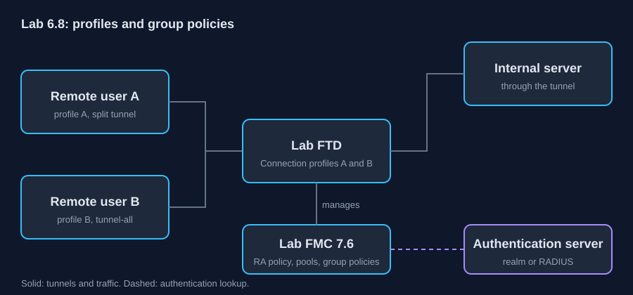

# Lab: Two connection profiles, two group policies

Video: [Remote Access VPN: Profiles, Interfaces, and Advanced Settings](https://youtu.be/hz7m2y2Tdps)
Reference: Cisco Secure Firewall Management Center Device Configuration Guide 7.6,
chapter 38 (PDF pages 1646-1691). Check the guide for your exact version.

> **Use a lab FMC/FTD or a virtual lab, never production.**

## Goal

Understand what the connection profile decides and what the group policy decides. You build two profiles with separate pools and group policies, compare split tunneling against tunnel-all, and prove that authentication fails before any group policy applies.

## Background

- The connection profile binds the access interface, the address assignment, the authentication method and server (AD/LDAP realm, RADIUS server group or the local realm), and the default group policy.
- Bind the profile to the internet-facing interface in the outside security zone, or clients cannot reach the gateway at all.
- Client address assignment offers three options: Use AAA Server (realm or RADIUS authorization only), Use DHCP Servers, and Use IP Address Pools (IPv4 and IPv6). If several are selected they are tried in the order AAA server, DHCP, then local pools.
- The connection profile gets the tunnel up and is evaluated first. The group policy shapes the session after authentication: DNS, split tunneling, client modules and timeouts.

## Prerequisites

- A lab management center and threat defense (7.6 or your version), the prerequisites from the previous lab, and an authentication server reachable from the device.
- Two lab users, one per profile or group.

Values you will use (keep them as placeholders in anything you share, never commit real values):

| Placeholder | What it is |
|---|---|
| `<PROFILE_A>` | first connection profile |
| `<PROFILE_B>` | second connection profile |
| `<POOL_A>` | address pool for profile A |
| `<POOL_B>` | address pool for profile B |
| `<GROUP_POLICY_A>` | group policy with split tunneling |
| `<GROUP_POLICY_B>` | group policy with tunnel-all |
| `<USER_A>` | lab user for profile A |
| `<USER_B>` | lab user for profile B |

## Steps

### Part 1: two profiles

1. Confirm the prerequisites: licensing, certificate enrollment, Secure Client image and a reachable authentication server.
2. Create an RA VPN policy bound to the outside interface and add `<PROFILE_A>` and `<PROFILE_B>` with separate pools (`<POOL_A>`, `<POOL_B>`) and group policies.
3. Set split tunneling in `<GROUP_POLICY_A>` and leave `<GROUP_POLICY_B>` as tunnel-all.

### Part 2: access and NAT

4. Add access control rules for each pool and the NAT exemption for both pools. Deploy.

### Part 3: compare and break

5. Connect as `<USER_A>` and `<USER_B>`. Compare the client routes, and confirm with `show vpn-sessiondb anyconnect` which profile, group policy and address each user received.
6. Fail an authentication on purpose and confirm the session is rejected before any group policy applies.

## Where this lab follows the documentation

The video presents the address choice as the IP address of the VPN interface versus a dedicated address assignment policy. Per the Cisco documentation, address assignment offers AAA server, DHCP servers and IP address pools, tried in that order when several are selected. This lab follows the documentation.

## Check your work

Use [checklist.md](checklist.md). If something does not work, start with
[troubleshooting.md](troubleshooting.md).

## Clean up

Delete the lab profiles, group policies, pools and the related rules, and deploy again.

---
*Always confirm behavior against the guide for your exact FMC/FTD version. Independent training by Hexward Labs; not affiliated with or endorsed by Cisco Systems.*
