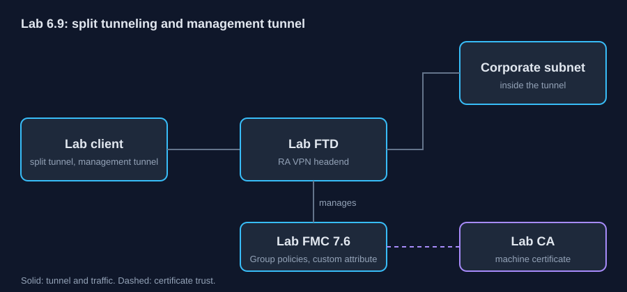

# Lab: Shrink the tunnel, split tunneling and the management tunnel

Video: [Split Tunneling, Management Tunnels, and Client Modules](https://youtu.be/0qHTNDs6CNY)
Reference: Cisco Secure Firewall Management Center Device Configuration Guide 7.6,
chapter 38 (PDF pages 1641-1644, 1692-1696 and 1718-1734). Check the guide for your exact version.

> **Use a lab FMC/FTD or a virtual lab, never production, and a lab CA for machine certificates.**

## Goal

Send only what must go through the tunnel. You compare full tunnel, split tunnel by network and dynamic split by domain, and, with a lab CA, build a management tunnel that comes up before login using a machine certificate.

## Background

- Full tunnel sends all traffic to the firewall (maximum control, highest load). Split tunneling by network sends only listed corporate networks through the tunnel. Dynamic split tunneling includes or excludes domain names, useful for cloud services whose IP addresses change, and is set with a Secure Client custom attribute in the group policy.
- The management VPN tunnel is always on and comes up before the user logs in, so IT can patch and push policy. Nobody types a password, so the device authenticates with a machine certificate; if it is missing or invalid the tunnel silently fails.
- Client modules (for example Umbrella roaming or Secure Endpoint) are attached in the group policy under Secure Client > Client Modules, with their module profiles uploaded as Secure Client files.
- Per-app VPN for mobile tunnels only selected applications by application ID. Check the guide for licensing and MDM requirements of your release.

## Prerequisites

- A working RA VPN policy from the previous labs and a lab client.
- For the management tunnel: a lab CA, a machine certificate for the client, and the Secure Client VPN Webdeploy package 4.7 or later uploaded.

Values you will use (keep them as placeholders in anything you share, never commit real values):

| Placeholder | What it is |
|---|---|
| `<INSIDE_SUBNET>` | the internal subnet used for split tunneling |
| `<TEST_DOMAIN>` | a domain used for dynamic split exclusion |
| `<MGMT_PROFILE>` | connection profile for the management tunnel |
| `<MGMT_GROUP_POLICY>` | group policy for the management tunnel |
| `<LAB_CA>` | your lab certificate authority |

## Steps

### Part 1: full tunnel baseline

1. Connect a lab client on full tunnel. Note the client route table and the session byte counters (`show vpn-sessiondb anyconnect`).

### Part 2: split tunneling

2. Change the group policy to split tunneling for `<INSIDE_SUBNET>` only. Deploy, reconnect, and compare the routes.
3. Add a dynamic split exclusion for `<TEST_DOMAIN>` and confirm on the client that its traffic leaves locally.

### Part 3: management tunnel

4. With `<LAB_CA>`, issue a machine certificate to the client. Build `<MGMT_PROFILE>` with certificate authentication and `<MGMT_GROUP_POLICY>` (no banner, split-tunneling check included). Reboot the client and confirm the tunnel comes up before login.
5. Remove the machine certificate and confirm the management tunnel fails, then restore it.

## Where this lab follows the documentation

For the management tunnel, the video says to enable multiple certificate authentication and that a AAA server verifies the client certificate. Per the Cisco documentation, the management tunnel's connection profile uses certificate authentication: the machine certificate is validated by the threat defense against a trusted CA, with no user logged in and no AAA password check. Other documented requirements: Secure Client VPN Webdeploy package 4.7 or later, no banner in the management tunnel group policy, and a split-tunneling check in that group policy. This lab follows the documentation.

## Check your work

Use [checklist.md](checklist.md). If something does not work, start with
[troubleshooting.md](troubleshooting.md).

## Clean up

Remove the lab management profile and group policy, delete the lab machine certificate from the client, and deploy again.

---
*Always confirm behavior against the guide for your exact FMC/FTD version. Independent training by Hexward Labs; not affiliated with or endorsed by Cisco Systems.*
