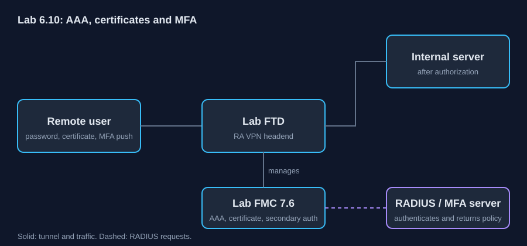

# Lab: Layer the factors, AAA, certificates and MFA

Video: [Remote Access Authentication: AAA, Certificates, and MFA](https://youtu.be/-tkC_x-cQp4)
Reference: Cisco Secure Firewall Management Center Device Configuration Guide 7.6,
chapter 38 (PDF pages 1696-1712). Check the guide for your exact version.

> **Use a lab FMC/FTD or a virtual lab, never production.**

## Goal

Make remote access harder to abuse. You move a profile from AAA only to client certificate plus AAA, add RADIUS-based secondary authentication, see why the default timeout breaks MFA pushes, and check what happens when RADIUS returns a group policy that does not exist.

## Background

- Authentication proves who you are, authorization decides what you get, accounting records who did what and for how long.
- Methods on a connection profile: AAA only (local, LDAP/AD realm, RADIUS), client certificate only, client certificate and AAA, and SAML. A profile can add secondary authentication, for example a RADIUS-based MFA push or token.
- A RADIUS server can return the group policy for a user. Every group policy it can return must exist in the RA VPN policy and be deployed; a name that does not match means the user does not get the intended policy.
- A push needs time for a human to respond. The Cisco documentation recommends a RADIUS timeout of 60 seconds or more for two-factor authentication; the default is 10 seconds.

## Prerequisites

- A working RA VPN policy from the previous labs.
- A lab RADIUS server with an MFA service, a lab CA and a lab client that can hold a certificate.

Values you will use (keep them as placeholders in anything you share, never commit real values):

| Placeholder | What it is |
|---|---|
| `<RADIUS_SERVER>` | lab RADIUS/MFA server |
| `<RADIUS_SECRET>` | shared secret; use a throwaway value and never commit it |
| `<GROUP_POLICY_NAME>` | group policy name returned by RADIUS |
| `<TEST_USER>` | a lab user |
| `<LAB_CA>` | your lab certificate authority |

## Steps

### Part 1: baseline

1. Start with a profile using AAA only and confirm a password login works.

### Part 2: certificate and AAA

2. Change to client certificate and AAA. Try to connect from a lab machine without a certificate and confirm it is rejected.

### Part 3: MFA and timeout

3. Add secondary authentication through `<RADIUS_SERVER>` using `<RADIUS_SECRET>`. With the default 10-second timeout, approve the push slowly and observe the failure. Raise the timeout to 60 seconds and test again.

### Part 4: group policy from RADIUS

4. Have RADIUS return `<GROUP_POLICY_NAME>` when it does not exist in the RA VPN policy and observe the result. Then add it, deploy and test again.
5. Confirm sessions with `show vpn-sessiondb anyconnect` and check the accounting records on the RADIUS server.

## Check your work

Use [checklist.md](checklist.md). If something does not work, start with
[troubleshooting.md](troubleshooting.md).

## Clean up

Remove the lab RADIUS object and secret, and reset the profile to your lab baseline. Deploy again.

---
*Always confirm behavior against the guide for your exact FMC/FTD version. Independent training by Hexward Labs; not affiliated with or endorsed by Cisco Systems.*
