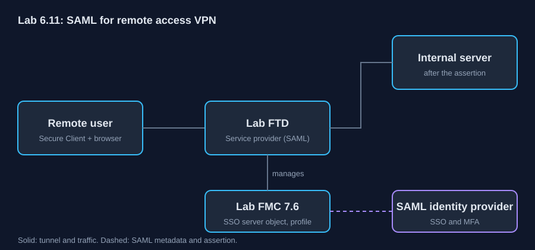

# Lab: SAML login for remote access VPN, end to end

Video: [SAML for Remote Access VPN](https://youtu.be/-xZeJ1EyCJw)
Reference: Cisco Secure Firewall Management Center Device Configuration Guide 7.6,
chapter 38 (PDF pages 1713-1717). Check the guide for your exact version.

> **Use a lab FMC/FTD or a virtual lab, never production, and a developer or trial IdP tenant.**

## Goal

Let an identity provider handle authentication and MFA for your VPN. You create the SAML application in a lab IdP, build the SSO server object from its metadata, switch the connection profile to SAML, log in with Secure Client, break the base URL on purpose and check the clock.

## Background

- The identity provider (for example Microsoft Entra ID or Okta) authenticates the user, including MFA, and issues the SAML assertion. The threat defense is the service provider and never sees the user's password. The management center holds and deploys the configuration.
- Flow: the user starts Secure Client, the threat defense redirects the browser window to the IdP, the user authenticates there, and the IdP returns a signed assertion that the threat defense validates.
- You need the IdP metadata (entity ID, SSO URL, optional logout URL and the IdP signing certificate) and the threat defense base URL exactly as users reach it. These go into a Single Sign-On server object that you then select as the SAML authentication on the connection profile.
- Assertions carry validity timestamps. If the firewall clock drifts from the IdP, valid assertions are rejected as expired or not yet valid, so keep NTP working everywhere.

## Prerequisites

- A working RA VPN policy, valid certificates on the threat defense and a lab client with Secure Client.
- A lab IdP tenant where you can create a SAML application, and a lab user.

Values you will use (keep them as placeholders in anything you share, never commit real values):

| Placeholder | What it is |
|---|---|
| `<BASE_URL>` | https URL of the threat defense exactly as users reach it |
| `<IDP_ENTITY_ID>` | entity ID from the IdP metadata |
| `<IDP_SSO_URL>` | SSO URL from the IdP metadata |
| `<IDP_CERT>` | IdP signing certificate |
| `<SSO_SERVER_NAME>` | name of the Single Sign-On server object |
| `<TEST_USER>` | a lab user in the IdP |

## Steps

### Part 1: IdP and SSO object

1. Create the SAML application in the lab IdP with `<BASE_URL>`.
2. Create the SSO server object `<SSO_SERVER_NAME>` from the IdP metadata (`<IDP_ENTITY_ID>`, `<IDP_SSO_URL>`) and enroll `<IDP_CERT>`.

### Part 2: connection profile

3. Set the connection profile's authentication method to SAML using `<SSO_SERVER_NAME>` and deploy.
4. Log in with Secure Client as `<TEST_USER>`, complete the IdP prompt, and confirm with `show vpn-sessiondb anyconnect`.

### Part 3: break and check

5. Change the base URL in the IdP to a wrong value, observe the failure, and fix it.
6. Compare the device time with the IdP and confirm NTP is synchronized.

## Check your work

Use [checklist.md](checklist.md). If something does not work, start with
[troubleshooting.md](troubleshooting.md).

## Clean up

Delete the lab SAML application and the SSO server object, and reset the connection profile to your lab baseline. Deploy again.

---
*Always confirm behavior against the guide for your exact FMC/FTD version. Independent training by Hexward Labs; not affiliated with or endorsed by Cisco Systems.*
