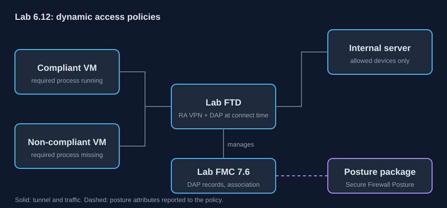

# Lab: Posture decides, dynamic access policies and session monitoring

Video: [Dynamic Access Policies and VPN Session Monitoring](https://youtu.be/H4LoKcCsGqs)
Reference: Cisco Secure Firewall Management Center Device Configuration Guide 7.6,
chapters 39 and 40 (PDF pages 1735-1755). Check the guide for your exact version.

> **Use a lab FMC/FTD or a virtual lab, never production.**

## Goal

Decide access at connect time from who the user is and the state of the device. You upload the posture package, build DAP records, show that an unassociated DAP does nothing, associate it, and watch a non-compliant device get rejected.

## Background

- At connection time DAP combines AAA attributes (user, group, authentication) with endpoint attributes (device posture) to allow, restrict or deny the VPN session.
- Prerequisites: a working RA VPN policy and AAA, a Secure Client license (Premier, Advantage or VPN Only), and the Secure Firewall Posture package uploaded as a Secure Client file (minimum version 4.6) so the client can report endpoint attributes.
- Build it: create the dynamic access policy and DAP records, add AAA criteria, add endpoint criteria (anti-malware, operating system version, running processes, files, registry keys, certificates), then associate the DAP with the RA VPN policy, save and deploy. Forgetting the association is the classic mistake.
- Monitoring: the VPN summary and remote access VPN dashboards show trends, active sessions show who is connected now, and user activity shows the history of logins and failures.

## Prerequisites

- A working RA VPN policy from the previous labs and a lab Windows VM as the client.
- A harmless lab process you can start and stop to stand in for a required agent.

Values you will use (keep them as placeholders in anything you share, never commit real values):

| Placeholder | What it is |
|---|---|
| `<DAP_NAME>` | name of the dynamic access policy |
| `<REQUIRED_PROCESS>` | the lab process that marks a compliant device |
| `<TEST_USER>` | a lab user |
| `<NONCOMPLIANT_VM>` | lab VM without the required process |

## Steps

### Part 1: build the DAP

1. Upload the Secure Firewall Posture package and create the dynamic access policy `<DAP_NAME>`.
2. Create one record that requires `<REQUIRED_PROCESS>` to be running and one record that terminates sessions that fail it.

### Part 2: without association

3. Deploy without associating the DAP. Connect from `<NONCOMPLIANT_VM>` as `<TEST_USER>` and note that it gets in.

### Part 3: with association

4. Associate the DAP with the RA VPN policy (edit the policy, select the dynamic access policy, save) and deploy. Repeat: the non-compliant VM should now be rejected.
5. Start `<REQUIRED_PROCESS>` on the VM and confirm it can connect.

### Part 4: monitor

6. Check active sessions with `show vpn-sessiondb anyconnect` and the user activity view in the management center.

## Where this lab follows the documentation

The video describes DAP as dynamic, continuous session evaluation. Per the Cisco documentation, the threat defense evaluates the DAP records when the user connects and authenticates; it is not a continuous re-check during the session. Endpoint attributes also require the Secure Firewall Posture package, minimum version 4.6. This lab follows the documentation.

## Check your work

Use [checklist.md](checklist.md). If something does not work, start with
[troubleshooting.md](troubleshooting.md).

## Clean up

Delete the lab DAP and its association, remove the posture package if you no longer need it, and deploy again.

---
*Always confirm behavior against the guide for your exact FMC/FTD version. Independent training by Hexward Labs; not affiliated with or endorsed by Cisco Systems.*
