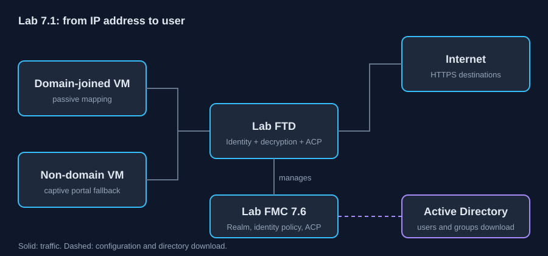

# Lab: From IP address to user, identity-based policies end to end

Video: [Cisco FMC Identity Policy Tutorial: User-Based Access Control with Cisco FTD](https://youtu.be/KFklKLNshSg)
Reference: Cisco Secure Firewall Management Center Device Configuration Guide 7.6,
chapter 69 (PDF pages 2453-2472). Check the guide for your exact version.

> **Use a lab FMC/FTD or a virtual lab, never production, and a lab Active Directory domain.**

## Goal

Make the firewall show who is behind an IP address. You connect a realm to your lab directory, build an identity policy with a passive rule and an active-authentication fallback, add decryption so active authentication can work for HTTPS, and write an access rule that matches a directory group.

## Background

- Identity flows through four objects: a realm (where users and groups come from), an identity policy made of identity rules (how to learn who a user is), an access control policy that references the identity policy, and access rules that match users or groups.
- A passive source maps an IP address to a user without asking anything. Active authentication uses a captive portal to ask the user to log in, and is the fallback for devices no passive source knows about.
- Captive portal can authenticate users only if HTTPS traffic is decrypted first, so active authentication needs a decryption policy with a Decrypt - Resign rule.
- The External Authentication object is for administrator logins to the management center or the device CLI. It is not what identity policies use.

## Prerequisites

- A lab management center and threat defense (7.6 or your version) with an inside zone that carries test traffic.
- A lab Active Directory domain and a service account with read access to it.
- One domain-joined VM and one VM that is not in the domain.
- A lab certificate authority whose certificate the lab VMs trust, for Decrypt - Resign.

Values you will use (keep them as placeholders in anything you share, never commit real values):

| Placeholder | What it is |
|---|---|
| `<LAB_DOMAIN>` | your lab Active Directory domain |
| `<DIRECTORY_SERVER>` | host name or IP of a lab domain controller |
| `<DIRECTORY_USER>` | read-only service account for the realm |
| `<LAB_AD_GROUP>` | a lab group used in the access rule |
| `<INSIDE_ZONE>` | the security zone your lab clients sit in |
| `<DOMAIN_JOINED_VM>` | lab VM that is a member of the domain |
| `<NON_DOMAIN_VM>` | lab VM that is not in the domain |
| `<TEST_USER>` | a lab user who belongs to <LAB_AD_GROUP> |

## Steps

### Part 1: the realm

1. Create an Active Directory realm for `<LAB_DOMAIN>` (Integration > Other Integrations > Realms; menu paths vary slightly by version). Enter the AD primary domain, `<DIRECTORY_USER>` with its password, the Base DN and the Group DN.
2. Add `<DIRECTORY_SERVER>` as the directory, click **Test**, and fix any error before moving on.
3. Download users and groups and confirm `<LAB_AD_GROUP>` appears in the list.

### Part 2: identity policy

4. Create an identity policy (Policies > Access Control > Identity) and add a rule with the **Passive Authentication** action for `<INSIDE_ZONE>`, using your realm.
5. In that rule, enable the option that falls back to active authentication when no passive identity can be established, and select the captive portal as the active identity source.

### Part 3: decryption and access control

6. Create a decryption policy with a **Decrypt - Resign** rule for traffic from users classified as **Unknown**, using your lab CA.
7. Associate both the identity policy and the decryption policy with your lab access control policy (in the policy's settings).
8. Add an access rule that matches `<LAB_AD_GROUP>` and allows your lab web traffic. Keep a rule for everyone else below it so you can compare. Save and deploy.

### Part 4: test

9. Log on to `<DOMAIN_JOINED_VM>` as `<TEST_USER>` and browse a lab web server. In the connection events (Analysis > Connections > Events), confirm the **User** column shows the directory user, not only an IP address.
10. Browse the same site from `<NON_DOMAIN_VM>`. Confirm the captive portal prompt appears, log in, and compare the user names in the connection events with the first test.
11. On the threat defense CLI run `show conn` and confirm the flows for the test hosts match what the events show.

### Part 5: break it on purpose

12. Remove the decryption policy from the access control policy, deploy, and try an HTTPS site from `<NON_DOMAIN_VM>`. Expect active authentication to stop working for HTTPS, which is the documented requirement. Restore the policy and deploy again.

## Where this lab follows the documentation

Three points in the video differ from the Cisco documentation, and this lab follows the documentation. (1) The External Authentication object shown in the video controls administrator logins, not identity policies; identity policies use a realm. (2) Realm sequences are not supported in captive portal (active authentication) rules. (3) Captive portal can authenticate users only if HTTPS traffic is decrypted first, so treat decryption as mandatory for active authentication.

## Check your work

Use [checklist.md](checklist.md). If something does not work, start with
[troubleshooting.md](troubleshooting.md).

## Clean up

Remove the lab access rule, the identity and decryption policies if you no longer need them, and any lab certificates. Deploy once more so the threat defense no longer carries the lab configuration.

---
*Always confirm behavior against the guide for your exact FMC/FTD version. Independent training by Hexward Labs; not affiliated with or endorsed by Cisco Systems.*
