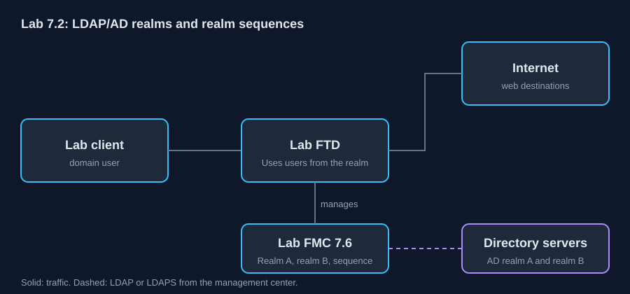

# Lab: Build and test an LDAP/AD realm and a realm sequence

Video: [LDAP/AD Realms, Realm Sequences, and Troubleshooting](https://youtu.be/2T4nDKTXR5U)
Reference: Cisco Secure Firewall Management Center Device Configuration Guide 7.6,
chapter 70 (PDF pages 2474 and 2499-2538). Check the guide for your exact version.

> **Use a lab FMC/FTD or a virtual lab, never production, and a lab Active Directory domain.**

## Goal

Build a realm the way you would in production: correct directory settings, an encrypted connection, a successful user and group download, a realm sequence, and one deliberate failure so you recognize the error when it matters.

## Background

- A realm is the directory the management center downloads users and groups from. It holds the AD primary domain, the directory credentials, the Base DN, the Group DN and one or more directory servers.
- Directory server settings are the host name or IP, the port and the encryption: none, STARTTLS or LDAPS. A CA certificate is needed only when you use STARTTLS or LDAPS.
- A realm sequence is an ordered list of Active Directory realms. LDAP realms cannot be part of a sequence, and sequences are not supported in captive portal rules.
- Order matters in a sequence, and you will test exactly how in this lab.

## Prerequisites

- A lab management center (7.6 or your version).
- Two lab Active Directory realms to point at (two domains, or one directory with two lab realms), each with a read-only service account.
- The CA certificate that signed the directory server certificate, for the LDAPS step.
- A user name that exists in both lab realms, for the sequence-order test.

Values you will use (keep them as placeholders in anything you share, never commit real values):

| Placeholder | What it is |
|---|---|
| `<REALM_A>` | name of the first lab realm |
| `<REALM_B>` | name of the second lab realm |
| `<AD_PRIMARY_DOMAIN>` | primary domain of the first lab directory |
| `<DIRECTORY_USER>` | read-only service account |
| `<BASE_DN>` | where the user search starts |
| `<GROUP_DN>` | where the group search starts |
| `<DIRECTORY_HOST>` | host name or IP of a lab domain controller |
| `<CA_CERT>` | CA certificate for LDAPS or STARTTLS |

## Steps

### Part 1: build the realm

1. Create the realm `<REALM_A>` (Integration > Other Integrations > Realms; menu paths vary slightly by version): AD primary domain `<AD_PRIMARY_DOMAIN>`, `<DIRECTORY_USER>` and its password.
2. Set the Base DN `<BASE_DN>` and the Group DN `<GROUP_DN>`. Use **Fetch DNs** to pick them instead of typing them.
3. Add the directory `<DIRECTORY_HOST>`. In an isolated lab only, first test with no encryption.

### Part 2: encrypt and test

4. Switch the directory to LDAPS (or STARTTLS), add `<CA_CERT>` as the CA certificate, and click **Test**.
5. Download users and groups and confirm the groups you expect are listed.

### Part 3: realm sequence

6. Create `<REALM_B>` the same way and make sure it downloads successfully.
7. Create a realm sequence that contains both realms. If you have an LDAP realm available, try adding it and note that it is not accepted.
8. Change the order of the realms in the sequence and observe which realm a user name that exists in both resolves to.

### Part 4: break it on purpose

9. Point the directory at a wrong DNS name, click **Test**, and write down the exact error.
10. Restore the correct name and test again until it passes.

## Where this lab follows the documentation

The video's walkthrough of port 389 and the CLI Access Attribute (`uid` versus `sAMAccountName`) belongs to the External Authentication object, which controls administrator logins to the management center or the device CLI. It is not part of a realm. A realm's directory settings are the host name or IP, the port, and the encryption. This lab follows the documentation.

## Check your work

Use [checklist.md](checklist.md). If something does not work, start with
[troubleshooting.md](troubleshooting.md).

## Clean up

Delete the lab realm sequence and any lab realms you no longer need, and remove the lab CA certificate from the management center if you added it only for this lab.

---
*Always confirm behavior against the guide for your exact FMC/FTD version. Independent training by Hexward Labs; not affiliated with or endorsed by Cisco Systems.*
