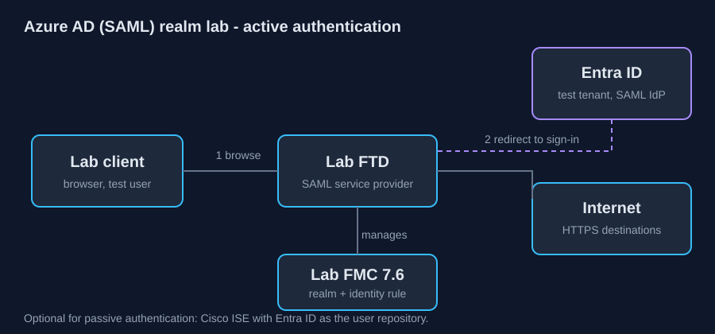

# Lab: Microsoft Azure AD (SAML) realm, cloud identity to firewall

Video: [Microsoft Azure AD Realms in the SAML Context](https://youtu.be/3fGXzAuIIyk)
Reference: Cisco Secure Firewall Management Center Device Configuration Guide 7.6,
chapter 70 (PDF pages 2474-2498). Check the guide for your exact version.

> **Use a lab FMC/FTD or a virtual lab, never production, and a test Entra ID tenant.**

## Goal

Build the bridge between Microsoft Entra ID (the current name for Azure Active Directory)
and the management center, so access control can use cloud identities instead of
nameless IP addresses. You will configure the realm, use it in an identity rule, and then
break it on purpose to see what the firewall does with an unresolved identity.

## Background in 60 seconds

- Classic Active Directory realms rely on LDAP binds to a local directory. Cloud identity
  in Entra ID needs **SAML**.
- A Microsoft Azure AD (SAML) realm maps Entra ID users and groups to traffic. It can also
  download groups from Entra ID.
- Two roles:
  - **Passive authentication**: users authenticate with Cisco ISE, which uses Entra ID as
    the user repository. No login prompt, requires ISE.
  - **Active authentication**: captive portal. The firewall is the SAML service provider,
    Entra ID is the identity provider (an SSO application). Explicit login, and the
    firewall needs to decrypt HTTPS traffic to redirect users.
- This lab uses **active authentication**.

## Prerequisites

- A lab FMC (on-premises 7.6 in the video) managing a lab FTD, or a virtual lab.
- Administrative access to a **test** Microsoft Entra ID tenant.
- A lab client VM behind the FTD that can browse the internet.
- Know the user and group limits of your FMC/FTD platform. Check them in the guide before
  syncing a large tenant, because identity sync can fail silently when limits are exceeded.

Values you will collect from the tenant (kept as placeholders in your notes, never commit
real values):

| Placeholder | What it is |
|---|---|
| `<TENANT_ID>` | Your Entra ID tenant identifier |
| `<SSO_APP_NAME>` | The SSO (enterprise) application you create for the firewall |
| `<IDENTIFIER_URLS>` | The identifier and URL values the realm asks for |
| `<SIGNING_CERT>` | The certificate Entra ID issues for the SSO trust |
| `<TEST_USER>` / `<TEST_GROUP>` | A test user and group created for this lab |

## Steps

Configure in this order: **cloud first, then the management center.** The firewall needs
the identifier URLs and certificate that Entra ID generates to establish trust.

### Part 1: Entra ID

1. In the test tenant, configure the Entra ID basic settings and create `<TEST_USER>` and
   `<TEST_GROUP>`. Add the user to the group.
2. For active authentication, create the SSO (enterprise) application `<SSO_APP_NAME>` for
   the firewall.
3. Collect the identifiers, URLs and certificate (`<IDENTIFIER_URLS>`, `<SIGNING_CERT>`)
   that the realm needs.

### Part 2: Management center

4. Create the **Microsoft Azure AD (SAML)** realm and enter the values you collected.
5. Download the groups from Entra ID into the realm. Confirm that `<TEST_GROUP>` appears.
6. Create an **identity rule** with active authentication that uses this realm.
7. Add a **decryption rule** with the **Decrypt - Resign** action for the users to be
   authenticated, so the firewall can redirect HTTPS sessions to the captive portal.
8. Add an **access control rule** for `<TEST_GROUP>`. Also add explicit rules for the
   special identities (see below) instead of letting them fall to the default action.
9. Deploy.

### Part 3: Test

10. From the lab client VM, browse to an HTTPS site and complete the Microsoft sign-in
    as `<TEST_USER>`.
11. Open the connection events and confirm the user appears by name.

### Part 4: Break it on purpose

12. In the SSO application, change one attribute so it no longer matches what the realm
    expects. Browse again with `<TEST_USER>`.
13. Observe: the user completes the Microsoft login page but is now classified as
    **Unknown**, and the access rule for Unknown applies. In the video's scenario that
    rule drops the traffic.
14. Fix the attribute mapping in the SSO application, re-check the identifier values in
    the realm, and confirm the user comes back by name with their groups.

## Special identities

When identity cannot be resolved, traffic is classified as one of: **Failed
Authentication**, **Guest**, **No Authentication Required** or **Unknown**. Write explicit
rules for each so a failure never surprises you through the default action.

## Check your work

Use [checklist.md](checklist.md). If something does not work, start with
[troubleshooting.md](troubleshooting.md).

## Clean up

Remove the test user, group and SSO application from the test tenant, and delete the lab
realm, identity rule and decryption rule from the lab FMC when you are done.

---
*Always confirm behavior against the guide for your exact FMC/FTD version. Independent
training by Hexward Labs; not affiliated with or endorsed by Cisco Systems.*
