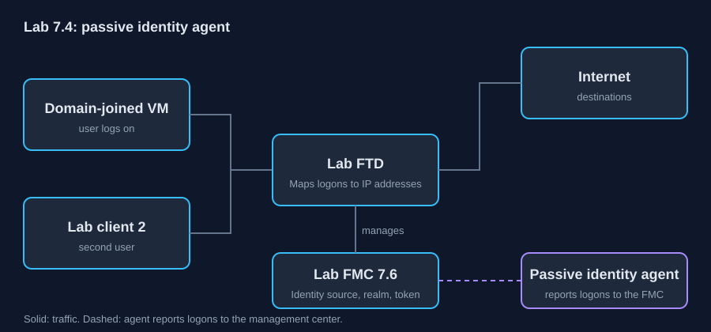

# Lab: Passive identity agent, mapping users without a login prompt

Video: [Passive Identity Agent: Recognizing Users Without a Login Portal](https://youtu.be/ioKDqCbZGgE)
Reference: Cisco Secure Firewall Management Center Device Configuration Guide 7.6,
chapter 71 (PDF pages 2539-2572). Check the guide for your exact version.

> **Use a lab FMC/FTD or a virtual lab, never production, and a lab Active Directory domain.**

## Goal

Recognize users without any prompt. You create the passive identity agent identity source, install the agent on a lab member server, watch user names appear in connection events, and add a second agent to prove failover.

## Background

- The passive identity agent is software you install on a member server. It reports user logons to the management center, so users are mapped to IP addresses without a login prompt.
- The required steps are: create a Microsoft AD realm, create the passive identity agent identity source, get the API token for the agent, and install the agent software.
- Enabling the dynamic attributes connector is optional, and Cisco ISE is not needed for this method.
- You can run a primary and a secondary agent. The documentation notes that the agent does not track user logoffs, so plan your tests with that in mind.

## Prerequisites

- A lab management center and threat defense (7.6 or your version) and a lab Active Directory domain.
- A lab member server for the agent, and a second one if you want to test the secondary agent.
- A domain-joined VM that sends traffic through the threat defense.
- The agent host must meet the security requirements listed in the guide.

Values you will use (keep them as placeholders in anything you share, never commit real values):

| Placeholder | What it is |
|---|---|
| `<LAB_DOMAIN>` | your lab Active Directory domain |
| `<FMC_ADDRESS>` | address of the lab management center |
| `<AGENT_API_TOKEN>` | token from the identity source; treat it as a secret and never commit it |
| `<AGENT_SERVER>` | lab member server that runs the primary agent |
| `<SECONDARY_AGENT_SERVER>` | lab member server for the secondary agent |
| `<TEST_USER>` | first lab user |
| `<TEST_USER_2>` | second lab user |

## Steps

### Part 1: realm

1. Create (or reuse) an Active Directory realm for `<LAB_DOMAIN>` and download its users and groups.

### Part 2: identity source and token

2. Create the passive identity agent identity source in the management center (Integration > Identity Sources; menu paths vary by version).
3. Get the API token for the agent and store it somewhere safe. In the examples below it appears only as `<AGENT_API_TOKEN>`.

### Part 3: install the agent

4. Check that `<AGENT_SERVER>` meets the security requirements in the guide.
5. Install the agent on `<AGENT_SERVER>`, enter `<FMC_ADDRESS>` and the token, and confirm the agent shows as connected in the management center.

### Part 4: test the mapping

6. Log on to a domain-joined VM as `<TEST_USER>`, browse through the threat defense, and confirm the user name appears in the connection events.

### Part 5: redundancy

7. Install a second agent on `<SECONDARY_AGENT_SERVER>` and configure it as the secondary.
8. Stop the primary agent service, log on as `<TEST_USER_2>`, and confirm the mapping still arrives. Start the primary again afterwards.

## Where this lab follows the documentation

The video calls enabling the dynamic attributes connector an absolutely crucial step. In the documented workflow it is optional. The video's description of how the agent collects logons is not stated in the guide either; check the guide's security requirements for the permissions the agent needs. This lab follows the documentation.

## Check your work

Use [checklist.md](checklist.md). If something does not work, start with
[troubleshooting.md](troubleshooting.md).

## Clean up

Stop and uninstall the lab agents, delete the passive identity agent identity source and the API token, and deploy again if any policy referenced the source.

---
*Always confirm behavior against the guide for your exact FMC/FTD version. Independent training by Hexward Labs; not affiliated with or endorsed by Cisco Systems.*
