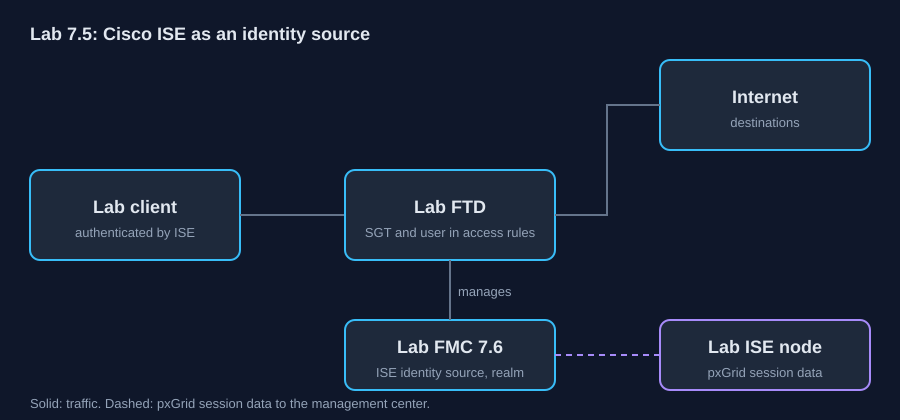

# Lab: Cisco ISE as an identity source, users and SGTs in access control

Video: [Integrating Cisco ISE or ISE-PIC](https://youtu.be/jvftEmY0c2o)
Reference: Cisco Secure Firewall Management Center Device Configuration Guide 7.6,
chapter 72 (PDF pages 2573-2598). Check the guide for your exact version.

> **Use a lab FMC/FTD or a virtual lab, never production, and a lab ISE node.**

## Goal

Bring Cisco ISE session data into the management center. You prepare ISE, run the quick configuration, subscribe to the Session Directory topic, write an access rule with an SGT as a source condition, and then see what a destination SGT rule needs.

## Background

- The integration uses pxGrid. The management center subscribes to the Session Directory topic to receive user and SGT session data.
- The SXP topic is optional. It is needed only if you want to match a destination SGT in access control rules (static IP-to-SGT mappings). SXP is not supported by ISE-PIC.
- The 7.6 quick configuration prepares ISE for you, but ISE still needs the services below enabled first.
- Domain names used by ISE and by the management center realm need to match, otherwise users from ISE will not line up with the realm.

## Prerequisites

- A lab management center and threat defense (7.6 or your version).
- A lab Cisco ISE node (or ISE-PIC) and a lab client that authenticates through it.
- An Active Directory realm in the management center for the same lab domain.
- Admin access to ISE to enable services and create one user.

Values you will use (keep them as placeholders in anything you share, never commit real values):

| Placeholder | What it is |
|---|---|
| `<ISE_NODE>` | host name or IP of the lab ISE node |
| `<ERS_OPERATOR_USER>` | ISE user in the ERS Operator group, used by the integration |
| `<LAB_REALM>` | the lab realm in the management center |
| `<SGT_NAME>` | a lab security group tag defined in ISE |
| `<LAB_CLIENT>` | lab client authenticated by ISE |
| `<DESTINATION_HOST>` | lab host that carries a destination SGT |

## Steps

### Part 1: prepare ISE

1. On `<ISE_NODE>`, enable ERS and the Open API with read/write access.
2. Disable the CSRF check for ERS and confirm the internal CA is enabled.
3. Create the ISE user `<ERS_OPERATOR_USER>` in the ERS Operator group. Keep its password out of anything you share.

### Part 2: connect the management center

4. In the management center, open the Cisco ISE identity source (Integration > Identity Sources; menu paths vary by version) and run the **quick configuration**. Review the results it reports.
5. Subscribe to the **Session Directory** topic. Leave the SXP topic off for now.
6. Run the connection test and confirm it passes.

### Part 3: SGT as a source condition

7. Create an access rule that uses `<SGT_NAME>` as a **source** condition. Confirm the SGT is offered as a choice in the rule editor. Deploy.
8. Authenticate `<LAB_CLIENT>` through ISE, browse through the threat defense, and check the connection events for the user name and the SGT.

### Part 4: destination SGT and SXP

9. Create a second rule that uses a **destination** SGT for `<DESTINATION_HOST>`, deploy, and test. Record what you see.
10. Enable the SXP topic (and SXP on ISE), deploy, and test the destination rule again. Compare with the previous result.

## Where this lab follows the documentation

The video lists SXP as a mandatory prerequisite. Per the Cisco documentation SXP is not required: the integration subscribes to the Session Directory topic, and the SXP topic is optional, needed only for destination SGT matching. This lab follows the documentation.

## Check your work

Use [checklist.md](checklist.md). If something does not work, start with
[troubleshooting.md](troubleshooting.md).

## Clean up

Remove the lab access rules, unsubscribe from the topics or delete the ISE identity source, delete `<ERS_OPERATOR_USER>` on ISE, and re-enable the CSRF check there if your lab needs it back.

---
*Always confirm behavior against the guide for your exact FMC/FTD version. Independent training by Hexward Labs; not affiliated with or endorsed by Cisco Systems.*
