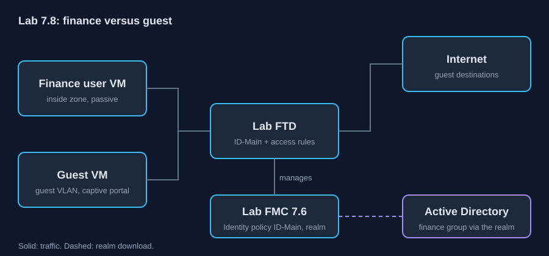

# Lab: Build and verify an identity policy, finance versus guest

Video: [Building and Verifying Identity Policies](https://youtu.be/EsXA-S-EAkk)
Reference: Cisco Secure Firewall Management Center Device Configuration Guide 7.6,
chapter 76 (PDF pages 2627-2650). Check the guide for your exact version.

> **Use a lab FMC/FTD or a virtual lab, never production, and a lab Active Directory domain.**

## Goal

Give one group seamless access and make another group log in. You build an identity policy with a passive rule for the inside network and an active rule for a guest VLAN, write access rules that use the resulting identities, and then prove what happens when the policy association is removed.

## Background

- An identity policy does not allow or block anything by itself. It identifies the user, and the access control policy it is associated with makes the allow or block decision.
- Identity rule conditions include zones, networks, VLAN tags, ports, and the realm with its authentication settings. FQDN network objects are not supported in identity rules.
- The actions are Passive Authentication, Active Authentication (captive portal) and No Authentication.
- Traffic without a known user is classified with a special identity (Failed Authentication, Guest, No Authentication Required or Unknown). Write access rules for these explicitly.
- Realms must work before you build the policy: if the users and groups were not downloaded, nothing can match.

## Prerequisites

- A lab management center and threat defense (7.6 or your version) with an inside zone and a guest VLAN.
- A lab Active Directory realm that downloads a finance group.
- A passive identity source or captive portal configured as in the earlier labs.
- One lab VM on the inside network and one on the guest VLAN.

Values you will use (keep them as placeholders in anything you share, never commit real values):

| Placeholder | What it is |
|---|---|
| `<LAB_REALM>` | the lab realm in the management center |
| `<INSIDE_ZONE>` | security zone of the inside network |
| `<INSIDE_NETWORK>` | IP network of the inside lab hosts |
| `<GUEST_ZONE>` | security zone of the guest VLAN |
| `<FINANCE_GROUP>` | lab directory group for finance users |
| `<FINANCE_SERVERS>` | network object for the lab finance servers |
| `<FINANCE_USER>` | lab user in <FINANCE_GROUP> |
| `<GUEST_USER>` | lab user who logs in on the guest VLAN |
| `<FQDN_OBJECT>` | a lab FQDN network object used for one test |

## Steps

### Part 1: prepare

1. Confirm `<LAB_REALM>` downloads `<FINANCE_GROUP>`.

### Part 2: build the identity policy

2. Create the identity policy `ID-Main` (Policies > Access Control > Identity).
3. Rule 1: source zone `<INSIDE_ZONE>`, network `<INSIDE_NETWORK>`, **Passive Authentication**, realm `<LAB_REALM>`, with the fallback to active authentication enabled.
4. Rule 2: source zone `<GUEST_ZONE>`, **Active Authentication** with the captive portal and a realm.
5. Try adding `<FQDN_OBJECT>` to a rule's network condition and note that it is not allowed. Remove it again.

### Part 3: associate and write access rules

6. Associate `ID-Main` with the access control policy (in the policy's advanced settings).
7. Add access rules: allow `<FINANCE_GROUP>` to `<FINANCE_SERVERS>`, allow guest users to the internet only, and block **Unknown** from internal subnets. Deploy.

### Part 4: test

8. Log in as `<FINANCE_USER>` on an inside VM and as `<GUEST_USER>` on the guest VLAN. Check the connection events for user names and for the rules that matched.

### Part 5: break it on purpose

9. Remove the identity policy association, deploy, and observe that user-based rules stop matching. Restore the association and deploy again.

## Check your work

Use [checklist.md](checklist.md). If something does not work, start with
[troubleshooting.md](troubleshooting.md).

## Clean up

Remove the lab access rules and `ID-Main` if you no longer need them, then deploy so the threat defense no longer carries the lab configuration.

---
*Always confirm behavior against the guide for your exact FMC/FTD version. Independent training by Hexward Labs; not affiliated with or endorsed by Cisco Systems.*
