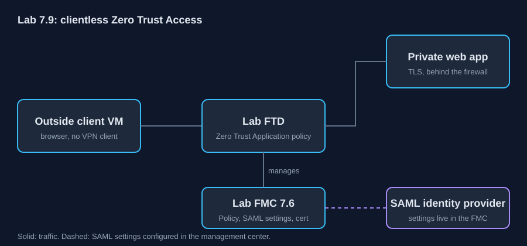

# Lab: Publish one private application with clientless Zero Trust Access

Video: [Cisco FMC Zero Trust Application Access (ZTNA): Policies, App Groups & Monitoring](https://youtu.be/W7tDtA2p-Lo)
Reference: Cisco Secure Firewall Management Center Device Configuration Guide 7.6,
chapter 53 (PDF pages 2031-2046). Check the guide for your exact version.

> **Use a lab FMC/FTD or a virtual lab, never production, and a test SAML identity provider.**

## Goal

Publish one internal web application without a VPN client. You check the prerequisites, build a Zero Trust Application policy with an application group and one application, authenticate through your test identity provider, and prove that nothing else is reachable.

## Background

- Clientless Zero Trust Access is configured in a separate Zero Trust Application policy, made of application groups and applications. It is not an access control rule.
- Users authenticate with a SAML identity provider. The threat defense acts as the SAML service provider, intercepts requests and redirects users to the identity provider.
- It requires Snort 3, supports only TLS-enabled web applications and supports only SAML identity providers.
- Documented prerequisites are an export-controlled smart license, a wildcard or SAN certificate matching the application FQDNs, a security zone, and a DNS record that resolves the application FQDN to the threat defense interface.

## Prerequisites

- A lab threat defense on 7.6 or your version, running Snort 3, with the device's own HTTP server not on port 443.
- A lab TLS web application behind the threat defense and a test SAML identity provider.
- A certificate that matches the application FQDN, and a DNS record for it that points to the threat defense interface.
- An outside-zone VM that acts as the remote user.

Values you will use (keep them as placeholders in anything you share, never commit real values):

| Placeholder | What it is |
|---|---|
| `<APP_FQDN>` | the FQDN users browse to |
| `<APP_SERVER>` | lab application server behind the firewall |
| `<APP_CERT>` | certificate (wildcard or SAN) that matches <APP_FQDN> |
| `<OUTSIDE_ZONE>` | security zone that faces the remote client |
| `<PORT_POOL>` | port pool used for the application |
| `<IDP_NAME>` | name of the test SAML identity provider |
| `<IDP_METADATA>` | metadata from the test identity provider; never commit real values |
| `<OTHER_INTERNAL_HOST>` | an internal host that is not published |

## Steps

### Part 1: prerequisites

1. Check the prerequisites: a Snort 3 device, the export-controlled license, `<APP_CERT>` matching `<APP_FQDN>`, a DNS record pointing to the firewall interface, and the device HTTP server not on port 443.

### Part 2: the policy

2. Create a Zero Trust Application policy (Policies > Access Control > Zero Trust Application; menu paths vary by version) with `<APP_CERT>`, `<OUTSIDE_ZONE>` and `<PORT_POOL>`.
3. Create an application group with the SAML settings of `<IDP_NAME>` (use `<IDP_METADATA>`), then add the lab web application at `<APP_SERVER>` to it.

### Part 3: deploy and test

4. Deploy. From the outside VM browse to `<APP_FQDN>` and complete the login at the identity provider.
5. On the threat defense CLI run `show running-config zero-trust`, `show zero-trust` and `show counters protocol zero_trust`, and confirm the configuration, sessions and counters.
6. Check that the connection events include the Zero Trust Application field and that the Zero Trust dashboard lists the application and the user.

### Part 4: prove the boundary

7. From the same VM try to reach `<OTHER_INTERNAL_HOST>` and confirm there is no path to it.

## Where this lab follows the documentation

The video builds zero trust access as an access control rule that combines an identity policy with application detectors. Per the Cisco documentation, clientless Zero Trust Access is configured in a separate Zero Trust Application policy with application groups and applications, and authentication is done by a SAML identity provider. This lab follows the documentation.

## Check your work

Use [checklist.md](checklist.md). If something does not work, start with
[troubleshooting.md](troubleshooting.md).

## Clean up

Delete the lab Zero Trust Application policy, the application group and the lab certificate, remove the DNS record, and deploy again.

---
*Always confirm behavior against the guide for your exact FMC/FTD version. Independent training by Hexward Labs; not affiliated with or endorsed by Cisco Systems.*
