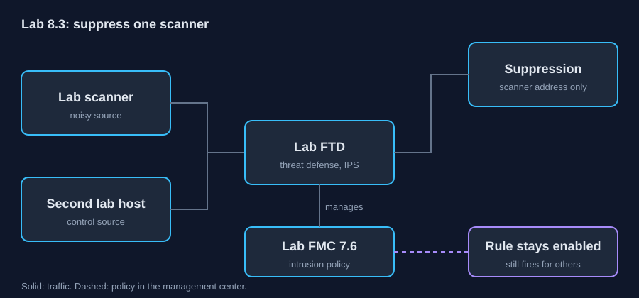

# Lab: Silence a scanner without blinding the IPS

Video: [Tuning Intrusion Rules Without Losing Context](https://youtu.be/bGBhBB2R-Ss)
Reference: Cisco Secure Firewall Management Center Device Configuration Guide 7.6,
chapter 57 (PDF pages 2097-2122). Check the guide for your exact version.

> **Use a lab FMC/FTD or a virtual lab, never production.**

## Goal

Quiet one known noisy source while the rule keeps protecting everything else. You find the flooding rule by its SID, add a suppression for the scanner address only, prove other hosts still generate events, and compare with a threshold.

## Background

- An internal vulnerability scanner can trigger the same intrusion rule thousands of times a minute. When the event view is flooded, analysts stop reading it and the one real attack gets lost. Disabling the rule removes the noise but also the protection for the whole network.
- Before you tune, check which inspection engine the device uses (Snort 2 or Snort 3), because the rule editor and options differ, and confirm the IPS license is assigned.
- The Intrusion Rules page supports keyword filters (SID, GID, CVE reference), character-string filters and combined filters, which narrow tens of thousands of rules to the one generating the noise.
- A threshold (type Limit, Threshold or Both; Track By source or destination; Count; Seconds) limits how many events a rule logs per period and suits a rule that is noisy across many hosts. A suppression (source or destination networks) stops events for that rule from or to specific addresses and suits one known host. Neither removes the rule from the policy.
- Record why a rule was tuned, as a rule comment where your editor offers one and in your change record. Tuning nobody can explain later is how good tuning gets undone.

## Prerequisites

- A lab management center and threat defense with the IPS license assigned (never production).
- A lab scanner host, a second lab host and a lab server. Only scan hosts you own.

Values you will use (keep them as placeholders in anything you share, never commit real values):

| Placeholder | What it is |
|---|---|
| `<INTRUSION_POLICY>` | the lab intrusion policy |
| `<NOISY_SID>` | the GID:SID of the flooding rule |
| `<SCANNER_IP>` | the lab scanner address |
| `<SERVER_IP>` | the lab server being scanned |
| `<SECOND_HOST>` | a second lab host used as a control |

## Steps

### Part 1: find the noise

1. Confirm the inspection engine version and that the IPS license is assigned.
2. From `<SCANNER_IP>` scan `<SERVER_IP>` and note the `<NOISY_SID>` that floods the intrusion events.
3. On the Intrusion Rules page filter by that SID.

### Part 2: suppress

4. Add a suppression for `<SCANNER_IP>` on that rule in `<INTRUSION_POLICY>` and add a comment explaining why.
5. Save, deploy and repeat the scan. Confirm the scanner's events stop.

### Part 3: prove the rule still works

6. From `<SECOND_HOST>` trigger the same rule and confirm the event still appears.
7. Optional: replace the suppression with a threshold (Limit, Track By Source, Count 1, Seconds 60) and compare event volume from both hosts.

## Where this lab follows the documentation

A threshold cannot be scoped to one address: it counts events per source or per destination (Track By) for every host that triggers the rule. To silence one specific scanner, use a suppression for that scanner's address or network.

## Check your work

Use [checklist.md](checklist.md). If something does not work, start with
[troubleshooting.md](troubleshooting.md).

## Clean up

Remove the lab suppression or threshold and deploy again.

---
*Always confirm behavior against the guide for your exact FMC/FTD version. Independent training by Hexward Labs; not affiliated with or endorsed by Cisco Systems.*
