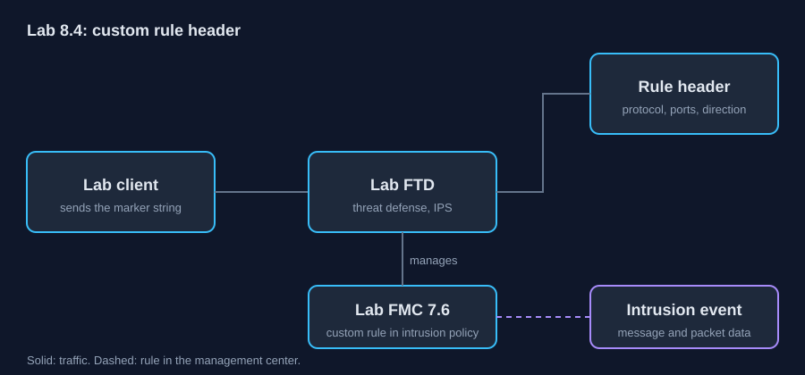

# Lab: Write and prove a custom intrusion rule

Video: [Custom Intrusion Rules: Headers, Direction, and Basic Options](https://youtu.be/K4kXCGAkahA)
Reference: Cisco Secure Firewall Management Center Device Configuration Guide 7.6,
chapter 58 (PDF pages 2123-2144). Check the guide for your exact version.

> **Use a lab FMC/FTD or a virtual lab, never production.**

## Goal

Describe something specific to your network in a rule and prove it. You write a custom rule for a marker string on a non-standard TCP port, enable it in the lab intrusion policy, deploy, trigger it safely, check the packet data, then change the direction and see the difference.

## Background

- Default rule sets cover known threats. When you see something specific to your network, such as an unusual protocol on a non-standard port between internal hosts, you may need to describe it yourself. A wrong header means the rule never matches or floods you with false positives.
- The rule header is evaluated first; if a packet does not match it, the more expensive payload checks never run. Header fields: action (for example alert), protocol (tcp, udp, icmp, ip), source address, source port, direction, destination address and destination port.
- Direction: `->` evaluates traffic from source to destination only. `<>` evaluates both directions, which matches more traffic and costs more processing; use it only when the pattern can appear either way.
- Rule options follow the header in parentheses: the message, a classification (which sets how the event is categorized and prioritized), the SID and revision, and detection options.
- The Transfer Packets option, set when you add the device and editable later in the device's general settings, lets the device send the packet data that triggered an event to the management center, not only the metadata.

## Prerequisites

- A lab management center and threat defense (never production).
- A lab client and a lab server that listens on a non-standard TCP port.

Values you will use (keep them as placeholders in anything you share, never commit real values):

| Placeholder | What it is |
|---|---|
| `<INTRUSION_POLICY>` | the lab intrusion policy |
| `<SERVICE_PORT>` | the non-standard TCP port of the lab service |
| `<MARKER_STRING>` | a harmless marker string for the lab |
| `<LOCAL_SID>` | a local SID of 1000000 or higher |
| `<CLIENT_IP>` | the lab client |
| `<SERVER_IP>` | the lab server |

## Steps

### Part 1: write the rule

1. Check the inspection engine version of the lab device.
2. Create a custom rule with a header like `alert tcp $HOME_NET any -> $HOME_NET <SERVICE_PORT>` and options for a message, a classification, `content:"<MARKER_STRING>";` and `sid:<LOCAL_SID>; rev:1;` (see the guide section for your version's exact syntax).
3. Add the rule to `<INTRUSION_POLICY>` and set it to Alert (Snort 3) or Generate Events (Snort 2).
4. Confirm Transfer Packets is enabled for the lab device.

### Part 2: prove it

5. Deploy, then from `<CLIENT_IP>` send traffic containing `<MARKER_STRING>` to `<SERVER_IP>` on `<SERVICE_PORT>`.
6. Open the intrusion events and confirm the event shows your message, classification and packet data.

### Part 3: direction

7. Change the direction to `<>`, redeploy and note how the rule now also matches the server's replies.

## Where this lab follows the documentation

A saved custom rule does nothing until it is enabled in the intrusion policy with its normal state or action (Snort 2: Generate Events or Drop and Generate Events; Snort 3: Alert or Block) and the policy is deployed. The "dynamic rule state" setting is a separate, rate-based feature.

## Check your work

Use [checklist.md](checklist.md). If something does not work, start with
[troubleshooting.md](troubleshooting.md).

## Clean up

Disable or delete the lab custom rule and deploy again.

---
*Always confirm behavior against the guide for your exact FMC/FTD version. Independent training by Hexward Labs; not affiliated with or endorsed by Cisco Systems.*
