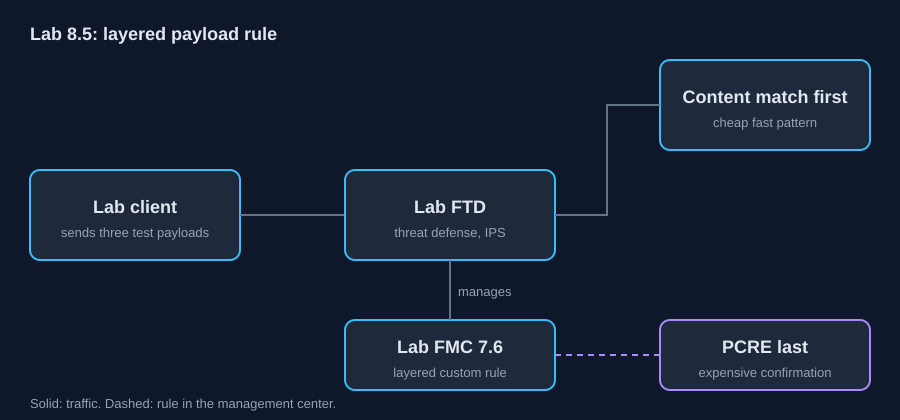

# Lab: Build a layered payload rule

Video: [Payload Matching: Content, Byte Operations, and PCRE](https://youtu.be/OYMYdqVfWh8)
Reference: Cisco Secure Firewall Management Center Device Configuration Guide 7.6,
chapter 58 (PDF pages 2145-2174). Check the guide for your exact version.

> **Use a lab FMC/FTD or a virtual lab, never production.**

## Goal

Write payload rules that are cheap first and precise last. You combine a content match on a marker string with a PCRE that confirms the full pattern, send three test payloads, explain which ones fire, and check performance statistics.

## Background

- Malware authors move payloads around inside the packet so a simple signature misses them. One heavy regular expression may catch them but inspects every packet expensively. Good payload rules are layered: a cheap check first, precise navigation second, and an expensive confirmation last.
- Check the engine first: rule syntax and behavior can differ between Snort 2 and Snort 3.
- Layer 1, content: the `content` keyword looks for a static string (the fast pattern). If the string is not in the packet, the rule stops being evaluated for that packet. `protected_content` matches a hash of the string instead of the clear text.
- Layer 2, byte operations: `byte_jump` reads a value and moves the detection pointer that many bytes; `byte_test` compares a byte value to confirm the position; `byte_extract` reads a value into a variable; `byte_math` calculates on an extracted value.
- Layer 3, PCRE: `pcre` matches complex patterns (case variations, wildcards, changing names) and is the most expensive option, so use it only after `content` has narrowed the traffic. In inline deployments `replace` can overwrite matched content with a string of the same length.

## Prerequisites

- A lab management center and threat defense (never production).
- A lab client and a lab server that can exchange test payloads.

Values you will use (keep them as placeholders in anything you share, never commit real values):

| Placeholder | What it is |
|---|---|
| `<INTRUSION_POLICY>` | the lab intrusion policy |
| `<MARKER_STRING>` | a harmless marker string for the lab |
| `<PCRE_PATTERN>` | a regular expression confirming the full pattern |
| `<LOCAL_SID>` | a local SID of 1000000 or higher |
| `<CLIENT_IP>` | the lab client |
| `<SERVER_IP>` | the lab server |

## Steps

### Part 1: build the rule

1. Check the lab device's inspection engine version.
2. Write a custom rule with `content:"<MARKER_STRING>";` followed by `pcre:"<PCRE_PATTERN>";` and `sid:<LOCAL_SID>; rev:1;`.
3. Enable it as Alert in `<INTRUSION_POLICY>` and deploy.

### Part 2: test three payloads

4. From `<CLIENT_IP>` to `<SERVER_IP>` send an exact match, one with changed capitalization, and one without the marker.
5. Confirm which payloads generate events and explain why (for example, whether the PCRE is case-insensitive).

### Part 3: measure

6. Review the intrusion performance statistics (see lab 8.10) before and after enabling the rule.

## Check your work

Use [checklist.md](checklist.md). If something does not work, start with
[troubleshooting.md](troubleshooting.md).

## Clean up

Disable or delete the lab rule and deploy again.

---
*Always confirm behavior against the guide for your exact FMC/FTD version. Independent training by Hexward Labs; not affiliated with or endorsed by Cisco Systems.*
