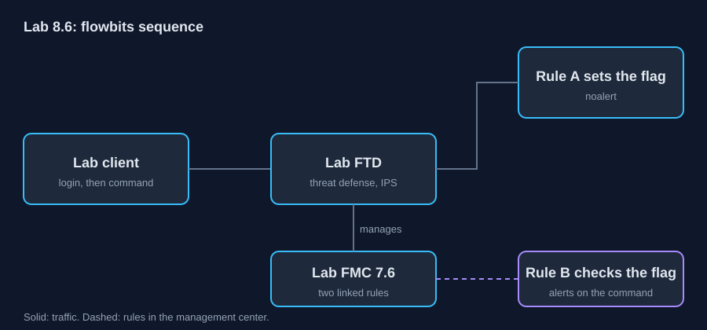

# Lab: Two rules, one memory (flowbits)

Video: [Cisco FTD Snort Intrusion Rules: Protocols, Flowbits & File Inspection Explained](https://youtu.be/VSi3uvhddpY)
Reference: Cisco Secure Firewall Management Center Device Configuration Guide 7.6,
chapter 58 (PDF pages 2175-2236). Check the guide for your exact version.

> **Use a lab FMC/FTD or a virtual lab, never production.**

## Goal

Detect a sequence instead of a single packet. Rule A records that a login was seen in the flow, Rule B only alerts on a specific command if that flag is set. You test with and without the first step, then separately review the file policy's archive inspection.

## Background

- Some attacks are harmless in any single packet and only malicious as a sequence: a login, then a specific command, then a payload. A rule that looks at each packet in isolation misses that. Flowbits let one rule remember what an earlier rule saw in the same flow.
- Engine differences: Snort 2 uses preprocessors and Snort 3 uses inspectors, so a Snort 2-specific setting does not carry over to Snort 3. Check the engine first.
- Protocol context: options such as `flow` and protocol-specific keywords tell a rule which part of which conversation to inspect. Without context a rule wastes effort and produces false positives.
- Flowbits: `flowbits:set,name;` sets the flag when Rule A matches; `flowbits:isset,name;` makes Rule B match only if the flag is already set; `flowbits:noalert;` lets Rule A record state without generating its own event. If Rule B omits `isset` or uses a different name, the sequence logic breaks.
- File policy is a separate feature: its rules decide what happens to files (Detect Files, Block Files, Malware Cloud Lookup, Block Malware), with options such as Spero analysis for Windows executables, dynamic analysis and storage by disposition. Inspect Archives does nothing useful unless the file policy contains file rules.
- Before deploying, the deployment preview, deployment history and the configuration version comparison report show what is added, changed or removed.

## Prerequisites

- A lab management center and threat defense (never production).
- A lab service where you can send a login string and then a command string in one session.

Values you will use (keep them as placeholders in anything you share, never commit real values):

| Placeholder | What it is |
|---|---|
| `<INTRUSION_POLICY>` | the lab intrusion policy |
| `<FLAG_NAME>` | the flowbit name used by both rules |
| `<LOGIN_STRING>` | the harmless login marker |
| `<COMMAND_STRING>` | the harmless command marker |
| `<SERVICE_PORT>` | the port of the lab service |
| `<SID_A>` | a local SID for rule A |
| `<SID_B>` | a local SID for rule B |
| `<FILE_POLICY>` | the lab file policy |

## Steps

### Part 1: the two rules

1. Check the lab device's inspection engine version.
2. Create Rule A: match `<LOGIN_STRING>` on `<SERVICE_PORT>` with `flowbits:set,<FLAG_NAME>; flowbits:noalert;` and `sid:<SID_A>`.
3. Create Rule B: match `<COMMAND_STRING>` on the same port with `flowbits:isset,<FLAG_NAME>;` and `sid:<SID_B>`.
4. Enable both as Alert in `<INTRUSION_POLICY>` and deploy.

### Part 2: test the sequence

5. Send only the command string and confirm no event.
6. Send the login, then the command in the same session, and confirm Rule B fires.
7. Remove `flowbits:isset` from Rule B, redeploy and observe the extra events. Restore it.

### Part 3: file policy, separately

8. Open `<FILE_POLICY>`, enable Inspect Archives and confirm at least one file rule exists. Review the deployment preview before deploying.

## Where this lab follows the documentation

File policy actions (Malware Cloud Lookup, Block Malware, Spero analysis, dynamic analysis, file storage) are file policy rule settings: the file policy is attached to an access control rule and works independently of intrusion rules. An intrusion rule cannot hand a file to the file policy through a flowbit. Intrusion rules can inspect file content with their own detection options. The two features are kept separate here.

## Check your work

Use [checklist.md](checklist.md). If something does not work, start with
[troubleshooting.md](troubleshooting.md).

## Clean up

Disable or delete the lab rules, restore the file policy and deploy again.

---
*Always confirm behavior against the guide for your exact FMC/FTD version. Independent training by Hexward Labs; not affiliated with or endorsed by Cisco Systems.*
