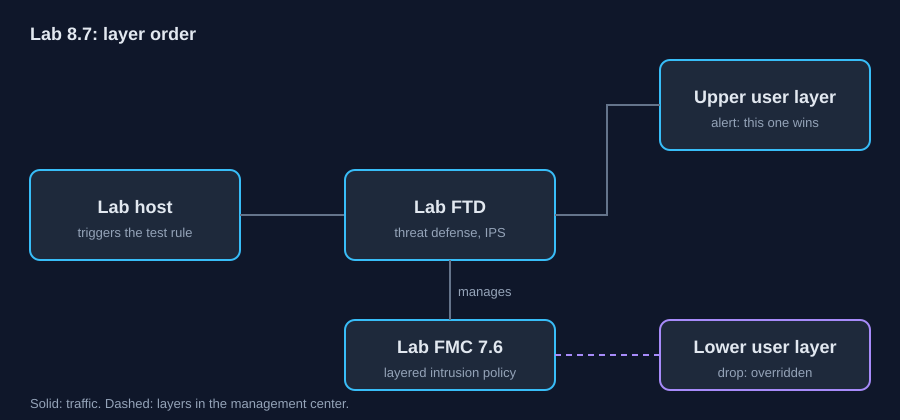

# Lab: Prove that layer order decides which setting wins

Video: [Cisco FMC & FTD: Policy Layers and Cisco Recommendations](https://youtu.be/vsWjXnKNKFk)
Reference: Cisco Secure Firewall Management Center Device Configuration Guide 7.6,
chapters 59-60 (PDF pages 2237-2258). Check the guide for your exact version.

> **Use a lab FMC/FTD or a virtual lab, never production.**

## Goal

Stop guessing why a change does not take effect. You generate recommendations, set one rule to drop in a lower user layer and to alert in a higher one, confirm the top layer wins, then swap the order and confirm the rule now drops.

## Background

- Intrusion policies are built from stacked layers and the order decides which setting wins. From the bottom: the base policy (Cisco or your own), the recommendations layer generated by the system (read-only, named Secure Firewall Recommendations in current releases), and user layers such as My Changes that can be shared between policies.
- Top wins: when the same setting appears in several layers, the highest layer decides. A rule set to drop in the base policy but to generate events (alert) in a higher user layer will alert.
- Recommendations use network discovery data (hosts, operating systems, services) to enable rules that are relevant to your assets and disable those that are not. Without discovery data they have nothing to work with.
- Prerequisites: check the inspection engine version, make sure the network discovery policy is collecting host data, and confirm you are editing the right intrusion policy.
- A user layer can be shared with other policies. Removing a setting from a shared layer changes every policy that uses it. A layer change also applies to all traffic the policy inspects; if only one source should be treated differently, consider an access control rule with a different intrusion policy for that traffic.

## Prerequisites

- A lab management center and threat defense with network discovery collecting hosts (never production).
- A lab host that can trigger a known rule safely.

Values you will use (keep them as placeholders in anything you share, never commit real values):

| Placeholder | What it is |
|---|---|
| `<INTRUSION_POLICY>` | the lab intrusion policy |
| `<TEST_RULE_SID>` | the GID:SID of the rule used for the test |
| `<LOWER_LAYER>` | the lower user layer |
| `<UPPER_LAYER>` | the higher user layer |
| `<TEST_HOST>` | the lab host that triggers the rule |

## Steps

### Part 1: recommendations

1. Check the engine version and confirm network discovery is collecting hosts in the lab.
2. In `<INTRUSION_POLICY>` generate the recommendations and review which rules they change.

### Part 2: conflicting layers

3. Pick `<TEST_RULE_SID>`. Set it to drop in `<LOWER_LAYER>` and to alert in `<UPPER_LAYER>`.
4. Use the deployment preview to see what will change, then deploy.
5. Trigger the rule from `<TEST_HOST>` and confirm the result matches the top layer (alert).

### Part 3: swap

6. Swap the layer order, redeploy and confirm the rule now drops.

## Check your work

Use [checklist.md](checklist.md). If something does not work, start with
[troubleshooting.md](troubleshooting.md).

## Clean up

Remove the lab layers and the test setting, then deploy again.

---
*Always confirm behavior against the guide for your exact FMC/FTD version. Independent training by Hexward Labs; not affiliated with or endorsed by Cisco Systems.*
