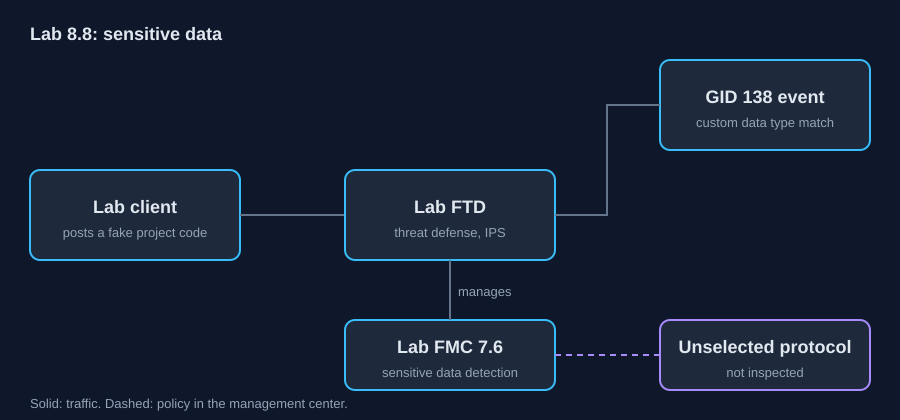

# Lab: Catch a project code leaving over HTTP

Video: [Cisco FMC & FTD: Sensitive Data Detection: Scope and Settings](https://youtu.be/gDCVvVCBCv4)
Reference: Cisco Secure Firewall Management Center Device Configuration Guide 7.6,
chapter 61 (PDF pages 2259-2270). Check the guide for your exact version.

> **Use a lab FMC/FTD or a virtual lab, never production.**

## Goal

Detect data that access rules cannot see. You create a custom data type for a fake project code, select HTTP and SMTP, send a test form, find the GID 138 event, and then confirm that the same string over an unselected protocol is not detected.

## Background

- An employee can send card numbers or internal project codes out over plain HTTP or email without any access rule noticing, because access rules look at addresses, ports and applications, not at the data. Sensitive data detection inspects the payload for patterns.
- It detects built-in data types (such as credit card numbers, email addresses, U.S. phone numbers and U.S. Social Security numbers) and custom data types you define. Global options set the baseline for the policy; individual options tune each type: data type, threshold (1-255 matches before an event), destination ports, application protocols (up to eight) and, for custom types, the pattern.
- Custom pattern syntax: `?` makes the preceding item optional, `{n}` means exactly n repeats and `\` escapes. Classes: `\d` digit, `\D` non-digit, `\l` letter, `\L` non-letter, `\w` letter or digit (no underscore), `\W` non-alphanumeric. Other characters, including dashes and spaces, are literal.
- Custom data types generate events with GID 138 and SIDs from 1000000. To drop offending packets in an inline deployment, the rule must be set to drop.
- Ports and protocols matter: traffic on ports or protocols you did not select is not inspected for sensitive data.

## Prerequisites

- A lab management center and threat defense with the required license (never production).
- A lab web server that accepts a test form. Use fake data only.

Values you will use (keep them as placeholders in anything you share, never commit real values):

| Placeholder | What it is |
|---|---|
| `<INTRUSION_POLICY>` | the lab intrusion policy |
| `<CUSTOM_TYPE_NAME>` | name of the custom data type |
| `<PROJECT_CODE_PATTERN>` | the pattern, for example the letters PRJ, a dash and four digits |
| `<FAKE_PROJECT_CODE>` | a fake code that matches the pattern |
| `<WEB_SERVER>` | the lab web server |

## Steps

### Part 1: create the type

1. Check the engine version and licensing for the lab device.
2. In `<INTRUSION_POLICY>` enable sensitive data detection and create `<CUSTOM_TYPE_NAME>` with `<PROJECT_CODE_PATTERN>` written in the simple syntax, for example `PRJ-\d{4}`.
3. Set the threshold to 1 and select HTTP and SMTP as application protocols. Deploy.

### Part 2: test

4. Post a test form containing `<FAKE_PROJECT_CODE>` to `<WEB_SERVER>`.
5. Confirm a GID 138 event appears.
6. Send the same string over a protocol you did not select and note that nothing is detected.

### Part 3: optional FTP

7. Add the FTP data protocol, keep the FTP Data detector enabled, include at least one port and enable a file policy in the access control policy, then test an FTP upload.

## Where this lab follows the documentation

Custom sensitive data patterns are not PCRE; they use a small, simple syntax. The documented configuration steps are done in the Snort 2 version of the intrusion policy, so check your release before planning around it. For FTP the documented requirements are: add the FTP data application protocol, keep the FTP Data detector enabled (it is by default), include at least one port to monitor, and enable a file policy in the access control policy.

## Check your work

Use [checklist.md](checklist.md). If something does not work, start with
[troubleshooting.md](troubleshooting.md).

## Clean up

Remove the lab data type and restore the policy, then deploy again.

---
*Always confirm behavior against the guide for your exact FMC/FTD version. Independent training by Hexward Labs; not affiliated with or endorsed by Cisco Systems.*
