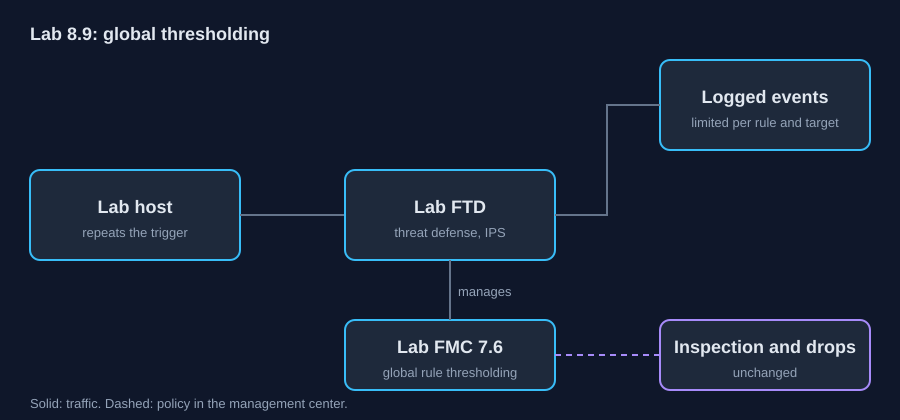

# Lab: Measure event volume before and after global thresholding

Video: [Cisco FMC & FTD: Controlling Intrusion Event Volume](https://youtu.be/r6x91RcXwjM)
Reference: Cisco Secure Firewall Management Center Device Configuration Guide 7.6,
chapter 62 (PDF pages 2271-2276). Check the guide for your exact version.

> **Use a lab FMC/FTD or a virtual lab, never production.**

## Goal

Keep the event view readable without turning any rule off. You count events from one noisy rule, set a global Limit threshold, repeat the test, and confirm that a different rule and a different target still generate events.

## Background

- On a busy network a single noisy rule can create thousands of identical events a minute. The real attack is hidden in the flood and the management center spends its resources writing duplicates. Global rule thresholding limits how often each rule logs.
- It limits event logging for every rule in the intrusion policy. It does not disable rules: packets are still inspected and a drop rule still drops. Only the number of logged events changes.
- Default: type Limit, Track By Destination, Count 1, Seconds 60, so each rule logs at most one event every 60 seconds for traffic to the same destination.
- Types: Limit logs the first Count events in the period and then stops for the rest of it. Threshold logs one event each time the rule matches Count times, then resets. Both logs one event per period once Count matches have been reached. Track By decides whether counting is per source or per destination.
- It is set in the intrusion policy's advanced settings (Global Rule Thresholding). Rule-specific thresholds (lab 8.3) are set on individual rules. You need an IPS license and should check the engine version first.

## Prerequisites

- A lab management center and threat defense with the IPS license assigned (never production).
- A lab host that can repeatedly trigger one rule and a second lab target.

Values you will use (keep them as placeholders in anything you share, never commit real values):

| Placeholder | What it is |
|---|---|
| `<INTRUSION_POLICY>` | the lab intrusion policy |
| `<NOISY_RULE>` | the rule you trigger repeatedly |
| `<TARGET_ONE>` | the first lab target |
| `<TARGET_TWO>` | a second lab target |

## Steps

### Part 1: baseline

1. Check the engine version and the IPS license. Note the current global threshold in `<INTRUSION_POLICY>`.
2. Generate repeated test traffic that triggers `<NOISY_RULE>` against `<TARGET_ONE>` and count the events per minute.

### Part 2: apply

3. Set Limit, Track By Destination, Count 5, Seconds 60. Deploy.
4. Repeat the test and compare the event count.

### Part 3: confirm coverage

5. Trigger a different rule, and the same rule against `<TARGET_TWO>`, and confirm both are still logged.

## Check your work

Use [checklist.md](checklist.md). If something does not work, start with
[troubleshooting.md](troubleshooting.md).

## Clean up

Restore the original global threshold values and deploy again.

---
*Always confirm behavior against the guide for your exact FMC/FTD version. Independent training by Hexward Labs; not affiliated with or endorsed by Cisco Systems.*
