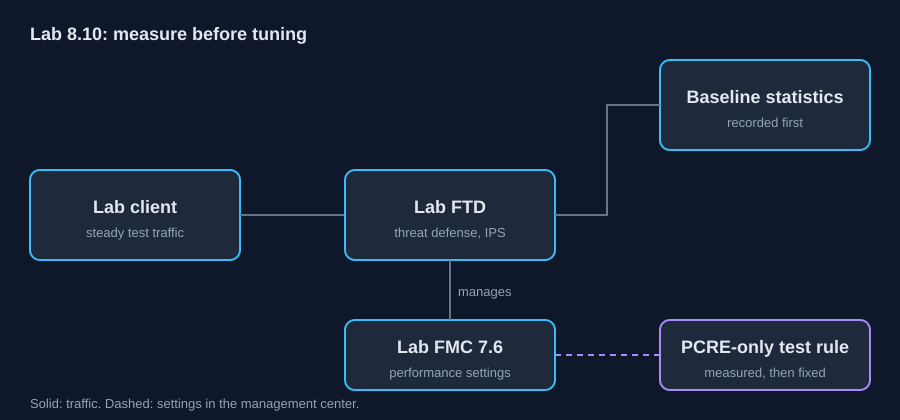

# Lab: Find the slow rule with measurements

Video: [Cisco FMC & FTD: Measurement-Based IPS Performance Tuning](https://youtu.be/SIoW5sZMhEk)
Reference: Cisco Secure Firewall Management Center Device Configuration Guide 7.6,
chapter 63 (PDF pages 2277-2290). Check the guide for your exact version.

> **Use a lab FMC/FTD or a virtual lab, never production.**

## Goal

Turn "the IPS is slow" into evidence. You record a baseline of performance statistics and `show asp drop`, add a rule that uses only a broad PCRE, measure the difference, add a strong content match and measure again.

## Background

- During a traffic peak the firewall slows down and applications time out. The usual cause is not the IPS in general but one expensive rule, often a custom regular expression. Turning rules off at random leaves the network exposed; measurement finds the cause and limits it.
- Before tuning, check the inspection engine version and know your platform's capacity. Performance settings are in the access control policy's advanced settings, and Cisco advises changing them only if you are experienced with Snort intrusion rules.
- Settings: pattern matching limits (maximum pattern states per packet); regular expression limits (PCRE Match Limit and Match Recursion Limit); per-packet event generation limits; packet latency thresholding (disabled by default, default threshold 256 microseconds); rule latency thresholding (default threshold 512 microseconds, suspension after 3 consecutive violations); and intrusion performance statistic logging.
- Trade-off: latency thresholding protects availability, but packets that skip inspection could contain attacks.
- Deploy safely: some deployments restart the Snort process. Check the deployment warnings; during a restart traffic may be dropped or pass uninspected depending on the device's settings.

## Prerequisites

- A lab management center and threat defense (never production).
- A lab client and server that can generate steady test traffic.

Values you will use (keep them as placeholders in anything you share, never commit real values):

| Placeholder | What it is |
|---|---|
| `<INTRUSION_POLICY>` | the lab intrusion policy |
| `<BROAD_PCRE>` | a deliberately broad regular expression |
| `<MARKER_STRING>` | a harmless marker string for the lab |
| `<LOCAL_SID>` | a local SID of 1000000 or higher |

## Steps

### Part 1: baseline

1. Check the lab device's engine version and note its model capacity.
2. Record a baseline: intrusion performance statistics and `show asp drop` output.

### Part 2: the expensive rule

3. Add a lab rule with only `pcre:"<BROAD_PCRE>";` and `sid:<LOCAL_SID>; rev:1;`, enable it in `<INTRUSION_POLICY>` and deploy. Watch for a Snort restart warning.
4. Send lab traffic and compare statistics and drops with the baseline.

### Part 3: fix and compare

5. Add a strong `content:"<MARKER_STRING>";` before the PCRE, redeploy and compare again.
6. Review the rule latency settings and note what would happen if the rule kept exceeding the threshold.

## Where this lab follows the documentation

Packet latency thresholding and rule latency thresholding are two different features. When the packet latency threshold is exceeded, inspection of that packet stops and the packet passes uninspected (a drop rule cannot drop it). Rule latency thresholding suspends the offending rules only after a set number of consecutive violations (default 3), for a set suspension time, and logs an event. Enabling service application monitoring under monitored interfaces is not part of the documented IPS performance tuning settings; use intrusion performance statistic logging and device health monitoring instead.

## Check your work

Use [checklist.md](checklist.md). If something does not work, start with
[troubleshooting.md](troubleshooting.md).

## Clean up

Delete the lab rule and deploy again.

---
*Always confirm behavior against the guide for your exact FMC/FTD version. Independent training by Hexward Labs; not affiliated with or endorsed by Cisco Systems.*
